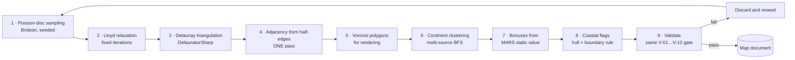
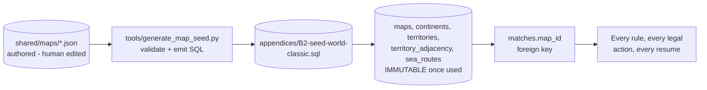

# Appendix C — Map Specification

> **In plain words.** This appendix is the map's specification: what a map file contains, the twelve
> rules every map must pass before a match can use it, what a sea route is, and how a map gets from a
> JSON file into the database. The classic 42-territory board is the only map that ships.

> **Deliverable N.** The map file format, the validation gate, the sea-route edge type, the procedural
> generation contract, and the retained submersion-mask design.

**Scope tiers.** §C.1–C.3 and §C.6 are `[P1]` — the authored classic board and its validation gate.
§C.4 and §C.9 (sea routes) are `[P2]`. §C.5 (procedural generation) and §C.7 (submersion masks) are
`[P3]`, deferred by D-47 and D-05 respectively.
>
> This appendix is the format-level expansion of [§5.7 Map System](../docs/05-system-design.md),
> [§7.11 Maps](../docs/07-game-design.md) and [§8.10](../docs/08-implementation-plan.md). The authored
> instance is [`shared/maps/world_classic.json`](../shared/maps/world_classic.json); this file specifies
> what any map — authored or generated — must satisfy to be loadable.

---

## C.1 The two edge types

The single most important distinction in this appendix, because conflating them breaks a locked rule.

| | **Land adjacency** | **Sea route** |
|---|---|---|
| Field | `territories[].neighbours` | Not in the map file at all |
| Where it lives | `territory_adjacency` | The **`sea_routes`** table, keyed by map (D-53) |
| Chosen by | The map author or generator | **The team**, authored once per map (D-37) |
| Count on the classic board | 83 | **Any number.** Ships empty; 8 proposed in §C.9 (D-59) |
| Used by normal attack | Yes | No |
| Used by Naval attack | No | **Yes** |
| Used by fortification | Yes | Yes, with Naval capability |
| **Used by Air Force range** | **Yes** | **No — excluded entirely** (C-08) |
| Symmetric | Yes, validated (V-01) | Yes, by construction |
| Frozen per match | Inherited from the map | Frozen at creation (FR-10) |

There is a third, *non*-edge concept that is easy to mistake for a sea route:

| | **`crossesWater`** |
|---|---|
| Field | Top-level `crossesWater` array |
| Meaning | **Render hint only.** Draw this land edge dashed, or with a bridge glyph |
| Mechanical effect | **None whatsoever** |
| Relationship to adjacency | A strict subset of the adjacency edges (V-12) |
| Count on the classic board | 10 |

`crossesWater` is the renamed `seaLanes` field from the source material (D-04). The rename is deliberate:
the term *sea route* is reserved for the authored Naval edge type, and one name for two different things
is how "Air Force uses sea routes for range" gets implemented by accident.

**Alaska–Kamchatka is a land adjacency that happens to cross water.** An attack across it is an ordinary
attack, it counts as one edge of Air Force range, and it requires no Naval capability.

---

## C.2 File format

`formatVersion: 2`. Version 1 was the source report's shape; version 2 adds `coastal`, `cardSymbol`,
`capabilities` and the `seaLanes` → `crossesWater` rename.

### Top level

```jsonc
{
  "key":           "world_classic",      // unique identifier; matches the filename stem
  "name":          "Classic World",      // display name
  "formatVersion": 2,
  "source":        { "kind": "authored" },              // or { "kind": "generated", "seed": 20260927 }
  "canvas":        { "width": 1600, "height": 900 },    // label coordinate space
  "continents":    [ /* ... */ ],
  "territories":   [ /* ... */ ],
  "crossesWater":  [ ["alaska", "kamchatka"] /* ... */ ]
}
```

| Field | Type | Required | Notes |
|---|---|---|---|
| `key` | string | Yes | `snake_case`. For a generated map, `generated:<seed>` |
| `name` | string | Yes | Display only |
| `formatVersion` | int | Yes | `2`. A loader rejects an unknown version rather than guessing |
| `source.kind` | `"authored"` \| `"generated"` | Yes | |
| `source.seed` | int | If generated | The seed that reproduces this map byte-for-byte |
| `canvas` | `{width, height}` | Yes | The coordinate space `label` is expressed in |
| `continents` | array | Yes | ≥ 1 |
| `territories` | array | Yes | ≥ `2 × maxPlayers` (V-08) |
| `crossesWater` | array of pairs | No | Render hints; defaults to empty |
| `_comment` | array of strings | No | Ignored by the loader. The authored file uses it to carry the asserted totals |

### `continents[]`

```jsonc
{ "key": "NA", "name": "North America", "bonus": 5, "colour": "#d4a05a" }
```

| Field | Type | Notes |
|---|---|---|
| `key` | string | Unique; referenced by `territories[].continent` (V-05) |
| `name` | string | Display |
| `bonus` | int ≥ 1 | Armies awarded for holding every territory in the continent (DR-09) |
| `colour` | hex string | Render hint |

### `territories[]`

```jsonc
{
  "key":          "alaska",
  "name":         "Alaska",
  "continent":    "NA",
  "label":        [110, 130],
  "coastal":      true,
  "cardSymbol":   "Cavalry",
  "capabilities": ["Infantry", "Cavalry", "NavalForce"],
  "neighbours":   ["northwest_territory", "alberta", "kamchatka"]
}
```

| Field | Type | Required | Notes |
|---|---|---|---|
| `key` | string | Yes | Unique, `snake_case`. The identifier used by the API, the database and the card deck |
| `name` | string | Yes | Display |
| `continent` | string | Yes | Must exist in `continents` (V-05) |
| `label` | `[x, y]` | Yes | Anchor for the name and the army badge, in `canvas` space |
| `coastal` | bool | Yes | **Authored input to CAP-1.** Not derived from geometry in an authored map |
| `cardSymbol` | enum | Yes | `Infantry` \| `Cavalry` \| `Artillery` \| `AirForce` \| `NavalForce` |
| `capabilities` | string array | Yes | The CAP-1 profile. **Redundant and asserted** (V-10) |
| `neighbours` | string array | Yes | Land adjacency. Symmetric, no self-loops, no duplicates (V-01…V-04) |
| `shape` | SVG path | **No** | Deliberately absent in v1 — see below |

#### Why `shape` is absent

Adjacency ships first; artwork is Phase 12. Phases 3–11 run on a debug renderer that draws each territory
as a labelled circle at `label` and each edge as a line. The engine, the agents and the entire test suite
are correct before a single polygon exists, which is what keeps artwork off the critical path (O-01).

A generated map *does* carry Voronoi polygons, because generating them is free once the triangulation
exists (§C.5 step 5).

#### Why `capabilities` is stored *and* derived

It is written explicitly so a client can render it and a map author can read it, and it is re-derived on
load by CAP-1 and asserted equal (V-10, TC-MAP-05) so the two can never drift after a hand edit. See
[Appendix D](D-capability-mapping-decision-table.md#d1-the-two-rules) for the full argument.

---

## C.3 The validation gate

Every map — authored, generated, or hand-edited — passes the **same** twelve rules before a match can use
it (FR-08). The validator lives in `Engine/Validation/MapValidator`, so the API, the simulator and the
offline clients cannot each apply a different standard.

| Rule | Check | Rejection is |
|---|---|---|
| **V-01** | Adjacency is symmetric — `b ∈ neighbours(a)` ⟺ `a ∈ neighbours(b)` | An asymmetric board where an attack is possible one way only |
| **V-02** | No self-loops | A territory adjacent to itself |
| **V-03** | No duplicate edges | A double-counted border |
| **V-04** | Every neighbour key exists | A dangling reference |
| **V-05** | Every `continent` key exists | An orphan territory |
| **V-06** | Continents partition the territories exactly — every territory in exactly one | A territory in two continents, or none |
| **V-07** | The land graph is connected | An unreachable island group, which makes domination impossible |
| **V-08** | `territories ≥ 2 × maxPlayers` | A board too small to deal |
| **V-09** | Every continent has ≥ 1 border territory | A continent that cannot be entered or left |
| **V-10** | Every stored `capabilities` array equals its CAP-1 derivation | Data drifted from the rule |
| **V-11** | No `NavalForce` card symbol on a landlocked territory | A naval card in a place with no coast (DR-17) |
| **V-12** | `crossesWater` pairs are a subset of the adjacency edges | A render hint for an edge that does not exist |

### A failing map is rejected, never repaired

A repaired map is a map nobody specified. The validator names the failed rule and the offending keys, and
the map does not load. For **generated** maps the response is different but equally strict: discard the
result and reseed (§C.5 step 9). Neither path patches a bad graph.

### Negative testing

The gate is only real if it has been shown to reject something. `tests/fixtures/invalid_*.json` holds
**one deliberately broken map per rule V-01…V-12**, and TC-MAP-01…05 plus that fixture set are what
verify it (§9.1 *Test data*). A validator with no negative tests is a validator that has never rejected
anything.

### Verified state of the authored board

The following are computed from `world_classic.json`, not asserted by hand:

| Property | Value |
|---|---|
| Territories | 42 |
| Continents | 6 — NA 9 / SA 4 / EU 7 / AF 6 / AS 12 / AU 4 |
| Continent bonuses | 5 / 2 / 5 / 3 / 7 / 2 |
| Undirected land edges | **83** |
| Asymmetric references | 0 |
| Self-loops | 0 |
| Dangling neighbour keys | 0 |
| Land graph connected | Yes |
| Coastal / landlocked | 36 / 6 |
| CAP-1 violations | 0 of 42 |
| `crossesWater` entries that are not land edges | 0 of 10 |
| Land-graph diameter | **10** |
| Territories missing a `label` | 0 |

---

## C.4 Sea routes `[P2]`

A sea route is a **per-map** edge type. It is authored in the map file and seeded into the `sea_routes`
table.

> **🔶 Rewritten by D-37 (October 2026).** This section previously described sea routes as a
> **per-match** edge type that *"does not appear in any map file"*, generated from a host-chosen count
> and frozen into `matches.effective_map`. Every part of that is now wrong. Routes are a **fixed list
> per map**, written by the team, and the team wants **more** of them than classic RISK has.

### The list is fixed, and the team writes it

| | Before (D-13) | **Now (D-37)** |
|---|---|---|
| Scope | Per **match** | Per **map** |
| In the map file? | No | **Yes** — a `seaRoutes` array |
| Who chooses how many | The host, at setup, within 2–10 | **The team**, once, unbounded |
| Who chooses endpoints | The system, from the match seed | **The team** |
| Stored in | `matches.effective_map` (jsonb) | The **`sea_routes` table** (D-53) |
| UI control | A stepper on S-05 | **None** — S-05 retired |
| Failure mode | `422` if the count could not be placed | None at match time; the **seed script** fails instead |

There is still no interface anywhere in the system — no API field, no client screen — for naming a
route's endpoints **during play**. Player-created routes remain an explicit §40 prohibition, and
[Appendix A](A-api-contract.md) is where their absence is visible in the contract. What changed is
*who authors the list and when*, not whether a player can draw one.

### Representation in the map file

`shared/maps/world_classic.json` carries a top-level `seaRoutes` array. It **ships empty** (D-59):

```jsonc
"seaRoutes": [
  // Chosen by the team. Each entry: { "a": "<territory_key>", "b": "<territory_key>" }
  // Both endpoints must be coastal, must not already be land neighbours, and the
  // unordered pair must be unique. tools/generate_map_seed.py refuses to emit an
  // invalid entry; the sea_routes table refuses to store one.
]
```

`tools/generate_map_seed.py` turns each entry into a `sea_routes` row. The server never reads the JSON
file at run time — the JSON is the human-edited source, the database is the runtime source (D-50).

### Validity rules — unchanged, and now checked three times

These were generator constraints. They are now **authoring** constraints, and they survived D-37 word
for word.

| Constraint | Key in `rules.json` | Hard? | Enforced by |
|---|---|---|---|
| Both endpoints coastal | `endpointsMustBeCoastal` | **Hard** — a landlocked territory is never an endpoint (DR-17, FR-51, FR-86) | Generator · `sea_routes` FK + `CHECK` · `verify_db.sql` V1 |
| Not already land-adjacent | `forbidExistingLandAdjacency` | **Hard** — a route duplicating a land edge adds nothing | Generator · `verify_db.sql` V2 |
| Not a duplicate route | `forbidDuplicate` | **Hard** | Generator · unique constraint on the ordered pair |
| Endpoints in different continents | `preferDifferentContinents` | **Soft preference**, never a rejection | Reviewed by eye |

Three enforcement points instead of one is a direct benefit of moving the list earlier: an invalid route
is now a problem you have on your laptop while running the seed script, not a `422` in front of the
committee.

### C.9 — Proposed route list for the team `[P2]`

> **⚠️ This is a proposal, not the seed.** `sea_routes` ships **empty** and
> `naval_force_enabled` defaults to `false` (D-54), so nothing below is live until the team accepts it
> and re-runs the generator. **D-59** records the decision to propose rather than decide.

Eight routes, every one **checked against the three hard rules by running the check**, not by eye.
`coastal` was read from each territory's `coastal` field and `land neighbours?` from its `neighbours`
array in `shared/maps/world_classic.json`.

| # | From | To | Joins | Both coastal? | Land neighbours? | The crossing |
|---|---|---|---|---|---|---|
| 1 | `brazil` | `south_africa` | S. America ↔ Africa | Yes | No | South Atlantic |
| 2 | `great_britain` | `eastern_united_states` | Europe ↔ N. America | Yes | No | North Atlantic |
| 3 | `scandinavia` | `quebec` | Europe ↔ N. America | Yes | No | North Atlantic, northern |
| 4 | `japan` | `alaska` | Asia ↔ N. America | Yes | No | North Pacific |
| 5 | `egypt` | `india` | Africa ↔ Asia | Yes | No | Suez and the Arabian Sea |
| 6 | `madagascar` | `western_australia` | Africa ↔ Australia | Yes | No | Indian Ocean |
| 7 | `indonesia` | `india` | Australia ↔ Asia | Yes | No | Bay of Bengal |
| 8 | `central_america` | `brazil` | N. America ↔ S. America | Yes | No | Caribbean and the Guianas |

**All eight pass.** Both endpoints coastal, no pair already a land border, no duplicate — and **all
eight join different continents**, which satisfies the soft preference as well. Verified against
`shared/maps/world_classic.json` on 14 October 2026 by reading the `coastal` and `neighbours` fields
directly; **not yet verified against a loaded database** (D-58), which is what `tools/verify_db.sql`
V1–V2 are for.

> **⚠️ The obvious choices are mostly illegal, and this is the trap worth knowing about.** Brazil ↔
> North Africa, Iceland ↔ Greenland, Great Britain ↔ Iceland, East Africa ↔ Middle East, Southern
> Europe ↔ North Africa, Indonesia ↔ Siam, Japan ↔ Kamchatka, Alaska ↔ Kamchatka — every one of those
> pairs looks like a shipping lane, and **every one of them is already a land border in classic RISK**.
> They are precisely the edges marked `crossesWater`: the client draws them dashed, but to the rules
> they are ordinary adjacency, usable by anyone with no Naval capability at all (§C.1, D-04).
>
> So `forbidExistingLandAdjacency` rejects all of them, and it is right to. A sea route duplicating a
> land edge would add nothing except a second way to make the same move. **A valid sea route has to be
> a crossing classic RISK does *not* already give you** — which is why the eight above are longer
> hauls: Brazil to South Africa rather than Brazil to North Africa.
>
> The board has **574 valid non-adjacent coastal pairs**, 516 of them cross-continent, so there is no
> shortage of choice. The eight above are a starting proposal, not a limit — D-37 explicitly supports
> any number.

### If the team wants to change the list

1. Edit `seaRoutes` in `shared/maps/world_classic.json`.
2. Run `python tools/generate_map_seed.py` — it **refuses** to emit a route that breaks a hard rule, so
   an invalid entry fails here, on a laptop, rather than in front of the committee.
3. Re-seed and run `tools/verify_db.sql` to confirm V1–V2 pass against the loaded data.
4. If any match already uses this map, the edit is a **new `maps` row**, not an edit (D-50). The
   procedure is in [`docs/16-task-day-change-guide.md`](../docs/16-task-day-change-guide.md).

> **⚠️ Enabling Naval Force against an empty `sea_routes` table gives the capability nothing to do.**
> The old design made this structurally impossible with `min = 2`; the new design cannot, because there
> is no generator to enforce a minimum. The risk did not vanish — it became a procedural warning, in
> [`docs/16-task-day-change-guide.md`](../docs/16-task-day-change-guide.md) §6.10 and in
> `shared/rules.json` under `navalForce`.

### What a sea route is not

- **Not a territory.** It cannot be owned, captured, garrisoned, or counted toward reinforcement (DR-16).
- **Not a cost.** Crossing consumes no units (NAV-1, `unitsRequiredPerRoute: 0`).
- **Not automatic.** A landlocked territory is never an endpoint; a coastal one gains nothing without a
  route actually touching it.
- **Not part of Air Force range.** Excluded entirely (C-08). Enforced *by construction*: the range BFS is
  handed the land adjacency graph, and sea routes live in **a separate table** that is never joined into
  it (D-53, §5.4). That is a stronger guarantee than a conditional, which could be edited away.
- **Not per-match.** Every match on a given map has the same routes. A map used by a match is immutable
  (D-50), so changing the list means a **new map row** — which is what preserves the old
  "frozen at creation" guarantee without the copy.


---

## C.5 Procedural generation `[P3]` — Deferred, future work

> **🔶 Deferred by D-47.** Not built. Only the authored classic board ships. The pipeline is kept
> because the **validation gate it feeds is not deferred** — V-01…V-12 run against the authored map
> exactly as described in §C.3 (FR-08) — and because a generated map would become a new immutable
> `maps` row like any other (D-50).

Seeded and deterministic: the same seed and parameters produce a byte-identical map (NFR-02, TC-MAP-06).



| Step | Implementation | Note |
|---|---|---|
| 1 | Poisson-disc (Bridson), seeded | Even spacing without a grid |
| 2 | Lloyd relaxation, fixed iteration count | Regularises cell sizes |
| 3 | DelaunatorSharp | |
| 4 | **One pass over half-edges** | See below |
| 5 | Voronoi cells from the triangulation | The renderer's polygons, free at this point |
| 6 | Multi-source BFS from spread seeds | Produces contiguous continents |
| 7 | `bonus = clamp(round(target × size × borders), 1, 10)` | `target` is the classic board's static-value band (§2.3) |
| 8 | Cells touching the hull, plus the continent-boundary rule | Authors `coastal`, the CAP-1 input |
| 9 | The same V-01…V-12 gate | **Failure discards and reseeds** |

### Step 4 matters more than it looks

Adjacency from a proximity threshold produces *almost* the right graph — and an almost-right adjacency
graph is an unplayable board with a plausible-looking picture. The triangulation already knows exactly
which cells share an edge, so the half-edge pass is both cheaper and exactly correct.

### Step 9's discard-and-reseed

Bounded by an attempt count. This is what lets steps 1–8 stay simple: generation is allowed to fail, and
the cheapest correct response is another seed rather than a repair pass on a bad graph.

### Parameters

```jsonc
{ "seed": 20260927,
  "params": { "territories": 42, "continents": 6,
              "minContinentSize": 4, "maxContinentSize": 12 } }
```

Symbols are dealt across the generated territory count in the authored board's 12/10/8/7/5 proportion
(Appendix D §D.6), then CAP-1 applies unchanged and **V-10 asserts it on generated maps exactly as on the
authored one**. There is no separate capability path for generated maps — which is what keeps a
procedural board compatible with the same engine (§42).

### Generated maps play through the same engine

| Consequence | Verified by |
|---|---|
| Same validation gate | TC-MAP-06…10 |
| Same engine, API and clients | TC-SYS-04 — a full match on a generated map |
| Variable territory count handled | The GNN state encoder (§C.7) and the `match_territories` row count, never 42 by assumption (TC-PER-02) |

---

## C.6 The map a match plays on

> **🔶 Renamed and rewritten by D-50 (October 2026).** This section was called *"Effective map"* and
> described a normalised **copy** of the board, frozen into `matches.effective_map` as a `jsonb`
> document at match creation. **That column no longer exists.** A match now **references** an immutable
> map by foreign key.

A match holds `map_id`. Everything the rules need is read through it, from the normalised map tables.



| Read through `map_id` | From | Used for |
|---|---|---|
| Continents and their bonuses | `continents` | Reinforcement calculation |
| Territories, coastal flag, card symbol | `territories` | Ownership, the deck, CAP-1 |
| Land adjacency | `territory_adjacency` | Attack, fortify, Air Force range |
| **Sea routes** | `sea_routes` | Naval actions (D-53) |
| Capability profiles | **Derived** by CAP-1, never stored | Extension legality (D-10) |

### The immutability rule, and its honest cost

**A map used by any match is never edited. A changed board is a new `maps` row** (FR-10, D-50).

| | Old mechanism | New mechanism |
|---|---|---|
| How a match is protected | A private frozen copy — editing the source was *structurally* unable to reach it | An **immutability rule** plus a foreign key |
| Guarantee | A map edit cannot alter a match in progress | **The same** |
| Enforcement | Impossible by construction | **A rule the team must honour** — plus the ERD and the data dictionary saying so |
| Cost | 42 territories duplicated per match, as JSON, unqueryable | One integer |

That difference is the one real thing given up, and chapter 6 §6.3 states it rather than hiding it:
*the protection moved from "cannot happen" to "must not be done"*. It buys a queryable map — the
database can answer *"do these two territories share a border?"* with a join instead of the server
parsing a blob — and it is why the ERD has a map region at all.

`match_territories` rows are inserted once from the referenced map: **42 for the classic board**, and
whatever a generated map would produce. **Never 42 by assumption** (TC-PER-02).

> **Editing `shared/maps/world_classic.json` mid-match still cannot alter a match in progress** — but
> for a different reason than before. Previously the match held a copy. Now the JSON is not read at run
> time at all: it is a build input to the seed generator, and re-running the generator against a map
> that a match already uses is the thing the immutability rule forbids. Chapter 16's
> *"changing the map"* procedure is written around exactly that.


---

## C.7 Submersion masks `[P3]` — design retained, not a requirement (D-05)

D-05: the mask feature is **out of v1 scope**. It has no FR, no phase and no v1 test case. What is
retained costs nothing and is recorded here so the option stays open:

| Retained | Where |
|---|---|
| The nullable `mask` column | `matches.mask` (Appendix B) |
| The normalisation step | §C.6 pipeline, a no-op when `mask` is null |
| This design section | Below |
| The GNN state encoder | **Retained independently** — procedural maps alone already produce variable territory counts |

### The design

A mask names territories that are submerged for a match. `MaskResolver` applies it during normalisation:

1. Remove the named territories.
2. Remove every adjacency edge touching them; remaining edges are unchanged.
3. **Remove the corresponding cards** — a card naming a drowned territory would make the +2 territory
   bonus unclaimable (FR-37).
4. Recompute `coastal` for territories that now border removed cells.
5. Re-derive capability profiles by CAP-1.
6. Re-run the **full** V-01…V-12 gate. A mask that disconnects the graph fails V-07 and is rejected.

### Why it needs no rules changes

A submerged territory simply **has no row** in `territory_state` and no card in `cards`. Nothing in the
engine counts to 42. Continent bonuses are recomputed from the surviving members, and a continent that
lost every territory is dropped along with its bonus.

Mid-match sinking would be a new action type (`SubmergeTerritory`) rather than a schema change, because
`moves.action` is stored verbatim as jsonb (Appendix B). That is the reason this feature can be deferred
without cost — and the reason deferring it is the right call: it is a *presentation-led* feature competing
with Phase 11's locked extensions.

---

## C.8 Traceability

| Item | Location |
|---|---|
| Authored instance | [`shared/maps/world_classic.json`](../shared/maps/world_classic.json) |
| Fast test board | `tests/fixtures/tiny_12.json` — 12 territories, curriculum stage 1 |
| Negative fixtures | `tests/fixtures/invalid_*.json`, one per V-01…V-12 |
| Requirements | FR-05…FR-10 (maps), FR-15, FR-16 (sea routes), FR-11, FR-39…41 (capability) |
| Decisions | D-04 (`crossesWater` rename), D-05 (mask out of scope), D-13 (SEA-1 bounds), D-14 (distribution) |
| Design | §5.7, §7.10, §7.11, §8.10 |
| Implementation | `Engine/Models/`, `Engine/Validation/MapValidator`, `Engine/Generation/` |
| Configuration | [`shared/rules.json`](../shared/rules.json) → `seaRoutes.*` |
| Tests | TC-MAP-01…10, TC-SEA-01…06, TC-PER-02, TC-PER-06, TC-SYS-04, TC-SYS-05 |

---

**Appendix index:** [A](A-api-contract.md) · [B](B-database-schema.sql) · C ·
[D](D-capability-mapping-decision-table.md) · [E](E-pseudocode.md) · [F](F-test-cases.md) ·
[G](G-configuration-tables.md) · [H](H-additional-diagrams-and-screenshots.md)
