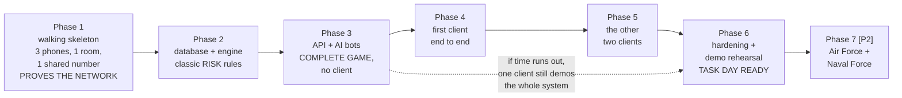

# 1 — Introduction

> **In plain words.** This chapter says what we are building and why. We are building a **prototype**
> of a RISK-style game: one laptop runs the rules, the database and the server; three Android phones —
> one Unity, one Godot, one Flutter — connect to it over a phone hotspot and play one game together,
> with human players and AI bots in the same match. Classic RISK first. The Air Force and Naval Force
> extensions come after that works, and ship switched off.

**Scope tiers used throughout this package:** `[P1]` demo-critical · `[P2]` the two extensions ·
`[P3]` deferred, documented but not built. Defined in
[`PROTOTYPE-EDITION.md`](PROTOTYPE-EDITION.md).

## 1.1 Background

Territory-conquest board games occupy a well-defined niche in strategy gaming: a shared map divided into
regions, armies placed on those regions, and conquest resolved by chance rather than by positional
calculation. RISK, first published in 1957, is the canonical example and remains the reference point for
the genre. Its rules are compact — reinforce, attack, fortify — yet the resulting decision space is
enormous, because the value of a territory depends on the whole board rather than on the territory
itself.

That combination makes the genre unusually well suited to a final-year software project. The rules are
small enough to specify exactly and test exhaustively, while the strategic depth is large enough that
building a competent computer opponent is a genuine engineering problem rather than a lookup table.

This project, **Order & Conquest**, is a digital territory-conquest game built on classic RISK rules
with **two** controlled extensions: an **Air Force** capability that attacks beyond adjacency, and a
**Naval Force** capability that operates over **sea routes**. A per-territory **capability profile**
system decides which of the two a player may use; it is the *mechanism* of the extensions rather than a
third extension, because Infantry, Cavalry and Artillery unlock nothing at all (D-09).

It is delivered as **one laptop** holding the rules engine, the REST API and a PostgreSQL database
(D-33), and **three thin Android clients** built on different engines — Unity, Godot and Flutter +
Flame (D-32). A heuristic AI opponent plays alongside the humans in the same match (D-35).

**It is a prototype (D-31).** The target is not a commercial game: it is a system that three students
with other coursework can finish, demonstrate on a phone hotspot with no internet, and defend in a
viva. Where completeness and feasibility disagree, feasibility wins. Reinforcement learning and
procedural map generation stay in this document as `[P3]` design work and are not built (D-47).

A prior student project, *Risk Conquest* (2022), addressed a similar problem at the same institution. It
is used in this document as a historical reference — for its requirement structure, its three AI
personalities, and several design faults worth correcting — and not as a specification. Where this
project departs from it, §2.4 and `00-decisions-and-assumptions.md` say so explicitly.

## 1.2 Problem Statement

Existing digital RISK implementations tend to fall into one of two groups. Commercial products are
closed, so their rules engines and AI cannot be studied or extended. Open student and hobby projects
typically implement the rules **inside the user interface**, which produces three specific failures:

1. **Rule logic is duplicated per platform.** Combat tie-handling, the escalating card-trade table, and
   the "one more army than dice rolled" constraint are exactly the rules that get subtly wrong. Three
   implementations mean three different subtle bugs — and matches that disagree with each other.
2. **The game cannot be replayed or resumed reliably.** When dice are rolled in the UI and outcomes are
   not recorded, a match cannot be reconstructed. That rules out save/resume, rules out replay, and
   rules out using the game as a training environment.
3. **The AI is tied to one client.** An agent written against a Unity scene cannot be reused, evaluated
   against other agents, or run headlessly for the millions of matches that learning requires.

There is a further, narrower problem. Extending RISK is easy to do badly. Adding air and naval forces
usually means adding unit types, movement costs, fuel, transport capacity and separate combat systems —
at which point the game is no longer RISK and the project is no longer finishable. The problem is
therefore not only *how to build* a digital RISK, but **how to extend it without the extension consuming
the project.**

## 1.3 Proposed Solution

Order & Conquest addresses both problems with one structural decision and one design discipline.

**The structural decision: one authoritative rules engine, on the server, with three thin clients.**

`OrderAndConquest.Engine` is a pure C# library with no I/O, no database and no framework dependency. Its
entire public surface is three methods:

```csharp
public interface IGameEngine
{
    GameState Start(MapData map, MatchOptions options, IRandomSource rng);
    IReadOnlyList<GameAction> Legal(GameState state);
    ApplyResult Apply(GameState state, GameAction action);   // -> new state + events
}
```

Randomness is injected and seeded; every random outcome is returned as an event rather than hidden; and
state transitions are pure functions. From those constraints, save/resume, full replay and deterministic
tests all follow without further work.

**The engine runs on the laptop and nowhere else (D-33).** The clients contain **no rules at all**.
`GET /legal` returns the list of actions currently available, so a client renders highlights for what
the server says is possible and nothing else. This is what makes three clients cost three times the
*drawing* rather than three times the *game* — and it is why a bug in the Godot client cannot produce a
different game from the Unity one.

> Purity still buys the *option* of compiling the engine into a client one day. That option is
> deliberately **not exercised** in this prototype: O-02 asked whether a phone could host the stack,
> and D-33 answered it by putting the host on the laptop. Nothing is compiled into a handset.

**The design discipline: the extensions reuse existing mechanics rather than adding new ones.**

- **Air Force** changes only the adjacency test for an attack — from "is adjacent" to "is within 5 land
  edges". Combat resolution, occupation and card award are untouched.
- **Naval Force** adds one new edge type to the map graph. A sea route behaves exactly like a land edge
  for a player holding Naval capability. There is no naval unit, no transport and no naval combat
  system.
- **Capability profiles** are derived from two authored fields per territory. Infantry, Cavalry and
  Artillery remain card symbols with no mechanical effect, exactly as in classic RISK; Air Force and
  Naval Force are the only two capabilities that unlock an action.

The result is that the entire extension set adds **two actions** and **one edge type**, and no second
combat system.

## 1.4 Objectives

| # | Tier | Objective | How completion is judged |
|---|---|---|---|
| **O1** | `[P1]` | Implement complete classic RISK rules in one deterministic, I/O-free engine | The unit-test suite in §9.2 passes, including exact dice-probability verification |
| **O2** | `[P1]` | Guarantee determinism: identical seed and action sequence reproduce identical state | TC-DET-01…04; replay of a completed match reproduces its final state byte-for-byte |
| **O3** | `[P1]` | Persist matches in a normalised PostgreSQL database so any match can be resumed | TC-PER-01…05 and TC-DB-01…11; a resumed match yields an identical legal-action set |
| **O4** | `[P1]` | **Play one match across three Android clients on a local network, with humans and bots in the same room** | The demo rehearsal of §9.7: three phones join one room over a hotspot, with no internet, and complete a match |
| **O5** | `[P1]` | Deliver three functional Android clients containing zero rule logic | §9.3; a source-level check confirms no client references combat, draft or card rules |
| **O6** | `[P1]` | Provide a competent heuristic AI opponent that the server runs itself | MarsBot defeats a uniform-random agent in ≥ 90 % of 1000 seeded matches |
| **O7** | `[P2]` | Add Air Force, Naval Force, sea routes and capability profiles without a second combat system | One code path resolves all combat (TC-AIR-03, TC-NAV-03 assert identical resolution) |
| **O8** | `[P3]` | *(Deferred)* Generate balanced procedural maps | Generated maps pass the same validation gate as the authored map. **Not built in this prototype** (D-47) |
| **O9** | `[P3]` | *(Deferred)* Train a reinforcement-learning agent that beats the heuristic AI | Head-to-head win rate > 50 % over ≥ 1000 seeded matches. **Not attempted in this prototype** (D-47, O-03). If it is never attempted, §10.3 reports that — a legitimate result |

**O1–O6 constitute the demonstrable prototype.** O7 is the extension work that follows it (D-36). O8
and O9 are deferred: they are specified here and in chapter 8 so the work is not lost, and **no other
objective depends on either**.

> **What changed, and why.** The previous objective list made procedural maps (O7) and three-client
> delivery equally mandatory and left the networked demo implicit. It is now explicit and `[P1]`,
> because "one match across three phones over a hotspot" is the thing the project is actually judged on
> (task day, D-34) — and it is the objective most likely to fail for reasons that have nothing to do
> with the rules engine.

## 1.5 Scope

### In scope

| Area | Tier | Contents |
|---|---|---|
| Core rules | `[P1]` | 42-territory classic board · 6 continents · 2–6 players · claim or random territory allocation · reinforcement · dice combat · occupation · fortification · territory cards · escalating set trading · elimination · world-domination victory · 100-round cap |
| Accounts | `[P1]` | Sign-up and login, required (D-38). Argon2id password hashing. A 12-hour token (D-61) |
| Architecture | `[P1]` | One pure rules engine **on the laptop** · ASP.NET Core REST with **polling** (D-43) · PostgreSQL **13-table** normalised persistence (D-40) · per-seat state redaction · optimistic concurrency on `matches.version` |
| Clients | `[P1]` | Unity · Godot · Flutter + Flame — all **Android, landscape only** (D-32), all thin, all driven by `GET /legal` |
| Mode | `[P1]` | **One: Room.** Remote human seats and AI seats in the same match (D-35, D-44). "Player vs AI" is a room with one human and bots; it is not a separate mode |
| Network | `[P1]` | Phone hotspot, **no internet at run time** (D-34). The laptop's IP is typed into each phone |
| AI | `[P1]` / `[P2]` | **PassiveBot and MarsBot `[P1]`**; ChaoticBot and AggressiveBot `[P2]` (D-56). The **server** runs AI turns (D-45) |
| Extensions | `[P2]` | Air Force (range 5, land adjacency only) · Naval Force (sea routes) · per-territory capability profiles · 6 card types · **a fixed sea-route list per map** (D-37) |
| Maps | `[P1]` | The authored classic board, stored as database tables (D-50), with the JSON file as the human-edited source |
| Deferred | `[P3]` | Procedural map generation · the reinforcement-learning agent · replay viewer (S-19) · tournament runner · SignalR/WebSocket transport · desktop and iPad layouts (D-47) |

### Out of scope

Everything in Part E of `00-decisions-and-assumptions.md`. The load-bearing exclusions:

- No diplomacy, alliances-as-a-rule, player trading, fog of war, commanders, heroes, resources, economy,
  tech trees or mission cards.
- No new unit types, hit points, fuel, airfields, bombing or transport capacity.
- No separate air or naval combat system — one resolution path only.
- No microservices, no required cloud infrastructure, no container orchestration.
- No rule logic in any client.
- **No internet requirement of any kind at run time** — no cloud service, no external API, no CDN, no
  font download (D-34). Fonts ship inside the apps.
- **No single-device play**, so no hand-over screen (D-44). **No guest sessions** (D-38). **No desktop
  or iPad layout** (D-32). **No turn timer** (D-65).
- Submersion masks are **optional** and not a v1 requirement (decision D-05).
- Free-text chat is not built (D-25); the design pack forbids any chat surface at all.

### Scope discipline

The governing rule for this project, stated so it can be checked: **a feature is not required because it
appears in the 2022 report, or because it is common practice.** Where a detail is unspecified, the
simplest implementation that works is chosen and recorded as an assumption. That register is
`00-decisions-and-assumptions.md`, and every assumption in it carries an ID.

The second governing rule, added October 2026: **a feature is not required because it is already
written down here.** D-47 defers seven subsystems that were previously in scope. Their text stays; the
work does not.

## 1.6 Target Users

| User | What they need | How the system serves it |
|---|---|---|
| **Casual player** | To play a familiar game without reading a manual | `GET /legal` drives the UI, so only legal moves are interactive — the rules are discoverable by trying |
| **Experienced RISK player** | Rules that are correct, including the edge cases | Exact dice probabilities verified statistically; escalating trade table and forced-trade conditions implemented and tested |
| **A group in one room, on their own phones** | To join one game quickly, with no accounts to chase and no internet | A 4-character room code (D-60) typed into each phone after the host's IP. Per-seat redaction means no player can see another's cards even though all three apps poll the same server |
| **Solo player** | A competent opponent | A room with one human seat and bot seats (D-44). The host picks bots **by name** — Passive or Mars for the demo (D-56) — and the server plays their turns (D-45) |
| **Developer / examiner** | A deterministic, inspectable system | Every die face is in the `moves` log; a match replays from its seed; the database refuses impossible states (chapter 6 §6.9) |
| **FYP evaluator** | Traceable requirements and honest reporting | Numbered FRs/NFRs with tier tags, a traceability matrix (§13), and results sections that state what is **measured** versus **planned** versus **not verified** |

> The "group at one device" user is gone, because pass-and-play is gone (D-44). The need it described —
> several people playing together in one room — is now served better: everyone uses their own phone and
> nobody has to look away while someone else takes a turn.

## 1.7 Limitations

Stated plainly, because an honest limitations section is worth more than an optimistic one.

| Limitation | Detail | Mitigation |
|---|---|---|
| **The laptop is a single point of failure** | Engine, API and database all run on one machine (D-33). If it sleeps, dies or changes IP, every phone stops | The runbook's pre-demo checklist disables sleep and pins the IP. §15.7 is the fallback plan |
| **A phone hotspot may isolate its clients** | Some Android hotspots block device-to-device traffic, which is exactly what this demo needs. This is a setting, not a bug, and it is invisible until you test | Tested in the 10-minute pre-demo check (§15.6). Fallback: a different phone's hotspot, or a travel router. This is the **highest-likelihood demo-day failure** |
| **Plain HTTP on the demo network** | There is no certificate authority on a hotspot, so traffic is cleartext and all three apps must be configured to permit it (D-49) | A demo-network decision, not a security position. Passwords are still Argon2id-hashed at rest (NFR-09); nothing sensitive is transmitted |
| **Polling adds up to a second of latency** | A client learns about another player's move on its next poll, not instantly (D-43) | Turn-based play makes this unnoticeable. The acting player's own action is applied in its response, so *their* screen never lags |
| **The database design is verified by computation, not yet by execution** | PostgreSQL was not available when chapter 6 was written, so the schema has not been loaded (D-58) | All 10 map and deck counts were independently recomputed in Python and agree. `tools/verify_db.sql` turns the remaining five claims into one command, and it is step 6 of the runbook |
| **Reinforcement learning is not attempted** | Risk has ≈ 3.3 × 10²⁴ opening positions. Published attempts have largely failed; the one clear success used a network as an evaluator inside a search, not as a direct policy | Deferred to `[P3]` (D-47). MarsBot is the shipped opponent, and §10.3 reports RL as not implemented |
| **Territory artwork is not part of the systems work** | 42 hand-traced polygons are an art task | Every screen is designed on a **board placeholder** instead, so artwork blocks nothing (O-01) |
| **No performance claims are made before measurement** | §10.4 is a **template**. It contains no numbers | NFR targets in §3.3 are stated as targets, and §9.6 records results only once measured |
| **Single-instance deployment only** | One API process, one database | NFR-23. Turn-based play has one writer at a time, so this is sufficient, not a compromise |

> Two limitations from the previous version are **resolved**, not mitigated. *"A server process is
> required even for single-player"* is no longer a limitation but the architecture (D-33). *"Flutter
> cannot run the stack on a handset"* was open question O-02; it is closed, because no client is asked
> to.

## 1.8 Development Methodology

### Incremental delivery, ordered by dependency

The project uses **seven phases over about 22–24 weeks** (§8 and
[`08-implementation-plan.md`](08-implementation-plan.md)), replacing the fourteen-phase plan written
before the prototype decisions. The ordering principle is stated once and applied throughout:

> **Make the core playable before advanced features can block progress** — and prove the *network*
> before the game, because the network is the part that cannot be debugged on demo morning.

Concretely: three phones talking to one server comes **first**, as a walking skeleton with no game in
it at all; then the rules; then one complete client; then the other two; then hardening; then the
extensions. Procedural map generation and reinforcement learning are not in the plan at all — they are
`[P3]` (D-47).



**Why the walking skeleton is first.** Every hard failure on a demo day is a network failure: the
hotspot isolates its clients, the firewall blocks the port, cleartext HTTP is refused by Android, the
laptop's IP changed overnight. None of those are visible in a game that has only ever run on one
machine. Phase 1 ships three phones showing one number that changes when any of them taps a button —
no rules, no database, no artwork — and it finds all four problems in week 2 instead of week 22.

### Test-first where determinism is the requirement

The engine's correctness properties are the kind that pass a manual playtest and still be wrong. Dice
tie-handling shifts every combat probability by a few percent, is invisible in play, and silently
poisons every agent trained against it. So the rules layer is developed against tests that assert exact
probability fractions and exact reproducibility rather than against observed gameplay. §9.2 lists them.

### Why not a heavier process

A single small team, a fixed specification and a fixed deadline. Sprints and ceremony would add
overhead without reducing risk; the real risk here is scope, and the countermeasure for scope is the
decision register and the anti-scope-creep checklist (`docs/14-implementation-safety-checklist.md`), not
a process framework.

### Tooling

| Purpose | Tool | Tier |
|---|---|---|
| Engine, API, data, AI | C# / .NET, ASP.NET Core, EF Core | `[P1]` |
| Database | PostgreSQL, on the laptop | `[P1]` |
| Clients | Unity (C#), Godot, Flutter + Flame (Dart) — **all Android, landscape** | `[P1]` |
| Map tooling | Python 3 (standard library only), `tools/generate_map_seed.py` | `[P1]` |
| Diagrams | Mermaid, in source, in these documents | `[P1]` |
| Screen design | One shared Figma file, built from `design/11-figma-prompt-mobile-landscape.md` | `[P1]` |
| Simulation | `OrderAndConquest.Sim`, headless | `[P3]` |
| RL training | Python, PyTorch; ONNX for interchange | `[P3]` |
| Contracts | OpenAPI generated from the API, then client SDKs generated from it | `[P3]` — three hand-written clients against ten endpoints do not need generated SDKs |

**Nothing in the `[P1]` row needs the internet at run time** (D-34). The Python tooling uses the
standard library only, so there is no `pip install` step to fail on a machine with no connection.

---

**Next:** [2 — Literature Review and Related Systems](02-literature-review.md)
