# 4 — System Analysis and Modelling

> **In plain words.** This chapter draws the system. It says who uses it (the actors), what each of
> them can do (the use cases), how data moves between the phones, the laptop and the database (the
> data-flow diagrams), and in what order things happen (the sequence and state diagrams). If you want
> to know *who is allowed to do what, and what happens next*, this is the chapter.
>
> Two things changed in October 2026 and they change almost every diagram here: **the laptop is the
> only place rules run** (D-33), and **everybody is remote** — there is no passing one phone around
> (D-44). So a player waiting for their turn is now waiting for *somebody else's phone*, not for the
> device in their hand.

> **Deliverables E, F, G.** Use cases, flowcharts, data-flow diagrams levels 0–2, sequence diagrams and
> the state diagram. All diagrams are Mermaid source, so they are diffable and regenerate on render.
>
> One modelling convention governs this chapter: **the engine is the only process that changes game
> state.** Every diagram below is drawn so that this is visible rather than asserted.

**Scope tiers.** `[P1]` demo-critical · `[P2]` the Air Force and Naval Force extensions · `[P3]`
deferred, documented but not built (D-47). Every use case, diagram and state machine below carries one
tag. Defined in [`PROTOTYPE-EDITION.md`](PROTOTYPE-EDITION.md).

## 4.1 System Overview `[P1]`

Order & Conquest is one authoritative server on a laptop, one rules engine inside it, and three thin
Android clients that render what the server reports (D-33). Analysis therefore separates cleanly into
three concerns:

| Concern | Question it answers | Modelled by |
|---|---|---|
| **Who does what** | Which actor triggers which capability | §4.2, §4.3 |
| **What flows where** | Which data crosses which boundary, and what is stored | §4.6–§4.8 |
| **What happens in what order** | Sequencing, concurrency and the legal phase transitions | §4.4, §4.5, §4.9, §4.10 |

### Actors

| Actor | Type | Tier | Description |
|---|---|---|---|
| **Registered Player** | Primary, human | `[P1]` | The only human actor. Signs up and logs in — there is no other way in (**D-38**). Holds one `Human` seat in a room, on their own phone |
| **Host** | Primary, human | `[P1]` | The Registered Player who created the room. The only seat that adds AI seats and starts the match. Otherwise an ordinary player |
| **AI Agent** | Secondary, system | `[P1]` | Occupies an `Ai` seat and selects an action from the engine's legal list (FR-71). **Runs on the laptop, driven by the server, not pulled by a client** (D-45, FR-73) |
| **Game Engine** | Secondary, system | `[P1]` | The sole authority on rules. Not a user, but appears in flow and sequence models because every state change passes through it |
| **Trainer** | Secondary, human | `[P3]` | A developer running headless simulation, tournaments and RL training (FR-79, FR-82). **Deferred by D-47** — no part of the demo |

> **🔶 `Guest Player` was an actor and is not any more.** **D-38** removed guest play: every seat needs
> an identity the server can address, and the reason the exemption existed — *"single-player must not
> require registration"* — went away with single-player itself (D-44). Registered Player absorbed
> every capability the guest had. **UC-03 is Retired**, not reassigned.

**`Neutral` is not an actor.** It is a seat kind with no agency: it owns territories and defends, but
never initiates anything (DR-15). Modelling it as an actor would imply behaviour it does not have. It
exists in 2-player matches only (D-62).

**No actor "hands over a device".** Each player holds their own phone for the whole match (D-44).

## 4.2 Use Case Diagram `[P1]`

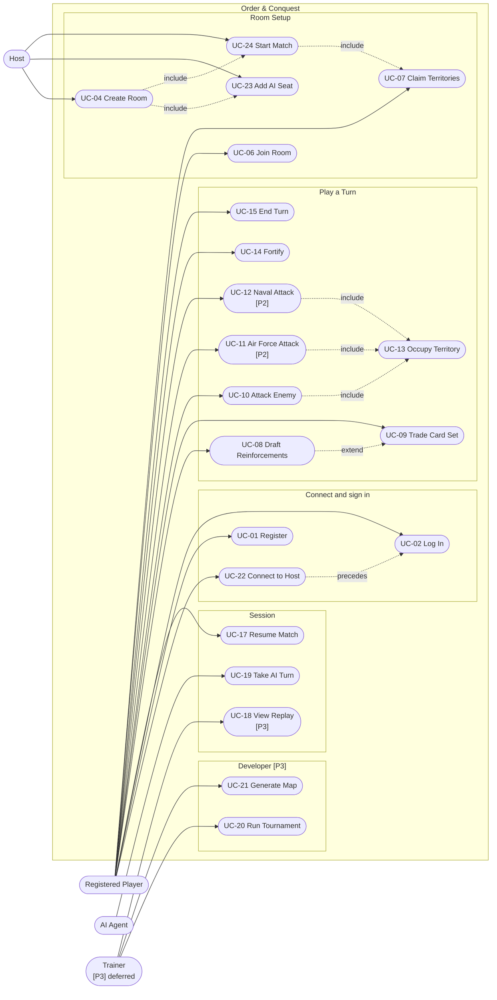

*Reading note:* **UC-22 comes first and is new.** Before anything else can happen, the phone has to be
told where the laptop is — on a hotspot there is no name server to ask (D-34, FR-88). Every human
capability now belongs to **Registered Player**, because there is no guest to share them with (D-38).
`Host` is that same person wearing the one hat that adds seats and presses *Start*.

### Use case index

Twenty-one identifiers were allocated; **three are Retired and keep their numbers** (§9 style rule:
never renumber). Three are new — UC-22, UC-23, UC-24 — and take the next free numbers.

| ID | Use case | Primary actor | FRs | Tier |
|---|---|---|---|---|
| UC-01 | Register account | Registered Player | FR-01 | `[P1]` |
| UC-02 | Log in | Registered Player | FR-02 | `[P1]` |
| UC-03 | ~~Play as guest~~ | — | — | **RETIRED** (D-38) |
| UC-04 | Create room | Host | FR-12, FR-13, FR-17, FR-18, FR-19, FR-92 | `[P1]` |
| UC-05 | ~~Configure sea routes~~ | — | — | **RETIRED** (D-37) |
| UC-06 | Join room | Registered Player | FR-13, FR-92 | `[P1]` |
| UC-07 | Claim territories | Player | FR-17, FR-21 | `[P1]` |
| UC-08 | Draft reinforcements | Player | FR-23, FR-24, FR-35 | `[P1]` |
| UC-09 | Trade card set | Player | FR-33, FR-34, FR-37 | `[P1]` |
| UC-10 | Attack an enemy territory | Player | FR-26…FR-31, FR-84, FR-85 | `[P1]` |
| UC-11 | Launch an Air Force attack | Player | FR-42…FR-46 | `[P2]` |
| UC-12 | Launch a Naval attack | Player | FR-47, FR-48, FR-50, FR-86 | `[P2]` |
| UC-13 | Occupy a captured territory | Player | FR-28, FR-30 | `[P1]` |
| UC-14 | Fortify | Player | FR-49, FR-52 | `[P1]` |
| UC-15 | End turn | Player | FR-25, FR-32 | `[P1]` |
| UC-16 | ~~Hand over device~~ | — | — | **RETIRED** (D-44) |
| UC-17 | Resume match | Registered Player | FR-04, FR-58, FR-93 | `[P1]` |
| UC-18 | View replay | Trainer | FR-59 | `[P3]` |
| UC-19 | Take AI turn | AI Agent | FR-71…FR-76 | `[P1]` |
| UC-20 | Run tournament | Trainer | FR-79, FR-82 | `[P3]` |
| UC-21 | Generate a map | Trainer | FR-07, FR-08 | `[P3]` |
| **UC-22** | **Connect to host** | Registered Player | FR-88, FR-91, FR-94 | `[P1]` |
| **UC-23** | **Add AI seat** | Host | FR-13, FR-72 | `[P1]` |
| **UC-24** | **Start match** | Host | FR-17, FR-18, FR-19, FR-87 | `[P1]` |

| | |
|---|---|
| Identifiers allocated | **UC-01…UC-24** |
| Retired | **3** (UC-03, UC-05, UC-16) |
| Live use cases | **21** — 16 `[P1]`, 2 `[P2]`, 3 `[P3]` |

## 4.3 Use Case Specifications

Specifications follow the template used by the 2022 report, for continuity with institutional
expectations (§2.4). **Every live use case is specified in full**, in numeric order, and the three
Retired ones keep a short stub saying what replaced them. The ones where the rules are non-obvious, or
where the new decisions change behaviour — UC-04, UC-08 to UC-13, UC-19 and the three new ones —
carry the most detail in their business-rule rows.

---

### UC-01 — Register Account `[P1]`

| Field | Content |
|---|---|
| **Use case name** | Register Account |
| **Actor(s)** | Registered Player (primary) |
| **Summary description** | A visitor creates an account so that matches can be resumed and a match history kept. |
| **Pre-condition** | The phone has reached the host (UC-22). The caller is unauthenticated. |
| **Post-condition** | A player row exists with a password stored as an Argon2id PHC string, and a bearer token is issued. |
| **Basic path** | 1. Visitor opens *Register* on S-02. 2. Visitor supplies a username, display name and password. 3. System checks the username is free. 4. System hashes the password with **Argon2id** and stores the PHC string (NFR-09, D-23). 5. System creates the player row and returns a token valid for 12 hours (D-61). |
| **Alternative path** | 3a. Username already taken → `409`; nothing created. 2a. Malformed body → `400`. 5a. Too many attempts → `429` and back off (NFR-10). |
| **Business rules** | The password is **never** stored, logged or echoed in plaintext or in any other form (NFR-09). The 2022 report stored `p_Password` in plaintext; D-23 records this as a correction, not a continuation. **Registration is required to play** (D-38) — there is no guest path to replace it. |
| **Non-functional** | NFR-09 — password at rest is an Argon2id PHC string. NFR-10 — the auth routes are the only rate-limited routes. |

---

### UC-02 — Log In `[P1]`

| Field | Content |
|---|---|
| **Use case name** | Log In |
| **Actor(s)** | Registered Player (primary) |
| **Summary description** | A registered player authenticates and receives a bearer token. |
| **Pre-condition** | The phone has reached the host (UC-22). A player row exists. |
| **Post-condition** | A bearer token is issued and the resumable-match list becomes reachable. |
| **Basic path** | 1. Player supplies credentials on S-02. 2. System verifies the password against the stored PHC string. 3. System returns a token and the player identifier. 4. S-03 loads the in-progress list (UC-17). |
| **Alternative path** | 2a. Unknown username **or** wrong password → `401` with **no distinction between the two cases**. 1a. Too many attempts → `429`. |
| **Business rules** | The single undifferentiated `401` is deliberate: distinguishing the two failures would confirm which usernames exist. The interface carries one error string for both (§08.2). The token lasts **12 hours with no refresh** (D-61), chosen so that a token issued on the morning of task day cannot expire during the demo. |
| **Non-functional** | NFR-10 — rate limited. |

---

### UC-03 — ~~Play as Guest~~ · **RETIRED**

> **🔶 Retired by D-38 (October 2026).** Sign-up and login are now required and there is no guest
> path. The reason this use case existed — *"single-player must not require registration"* (D-24) — was
> removed by **D-44**: there is no single-player mode any more, only a room with humans and bots, and
> every seat in a room needs an identity the server can address.
>
> | | |
> |---|---|
> | **The identifier is not reused** | §9 style rule. UC-22, UC-23 and UC-24 take the next free numbers |
> | **Where the capability went** | UC-01 (Register) and UC-02 (Log In). Registered Player absorbed every guest capability |
> | **What went with it** | FR-03 (Retired), the *Continue as guest* link on S-02, the "guest play needs neither route" section of `appendices/A`, and `NFR-24` as it was originally worded |
> | **Reversal cost** | Moderate — see D-38. The `users` table would need a nullable-credential row kind |

---

### UC-04 — Create Room `[P1]`

| Field | Content |
|---|---|
| **Use case name** | Create Room |
| **Actor(s)** | Host (primary) · Game Engine (secondary) |
| **Summary description** | The host selects the map, sets how many seats the room has, and creates it. The server issues a 4-character room code and opens a lobby. Seats are filled afterwards — by other players joining (UC-06) or by the host adding bots (UC-23) — and the match begins only when the host starts it (UC-24). |
| **Pre-condition** | The host is authenticated (UC-02). At least one map passes validation. |
| **Post-condition** | A match exists in `Lobby` with the configured seats, a room code, and version 1. **No territories are allocated and no armies are issued yet** — that is UC-24. |
| **Basic path** | 1. Host opens *Create room* (S-04). 2. System lists validated maps (FR-05). 3. Host selects a map — Classic world is the only option in this version. 4. Host sets the seat count, 2 to 6 (FR-12). 5. Host confirms. 6. System validates the map against the shared gate (FR-08). 7. System copies every rule setting into `match_rules` and freezes it (FR-87, D-52). 8. System issues a unique 4-character room code from the unambiguous alphabet (FR-92, D-60). 9. System persists the match and its empty seats in one transaction and returns the match in `Lobby`. |
| **Alternative path** | 4a. Host selects 2 seats → system inserts a third `Neutral` seat automatically and will apply the 3-seat army count at start (FR-14, D-62). 6a. Map fails validation → `422` naming the failed gate rule; no match created. 8a. Code collision with a live room → the system draws again; the caller never sees this. 9a. Transaction fails → nothing persisted; host may retry. |
| **Business rules** | Seats: 2–6 (FR-12). A 2-seat match becomes three seats with one `Neutral` (D-62). **The host configures no rules here** — no dice-face count, no attack range, no sea-route count, no mode card (D-37, D-39). The map is referenced, not copied; a map used by a match is immutable, and a changed board is a new map row (FR-10, D-50). |
| **Non-functional** | NFR-02 — the same seed and configuration must yield the same match setup. NFR-13 — creation is atomic. |

> **🔶 This use case shrank, and the three pieces it lost are worth naming.** It used to choose a
> sea-route count (**UC-05**, now Retired by D-37), generate and freeze an effective map (**D-50** —
> the map is now referenced, not copied), and deal armies in the same breath. Dealing is now a separate,
> explicit step — **UC-24** — because in a room the host creates first and *waits* for people to
> arrive.

---

### UC-05 — ~~Configure Sea Routes~~ · **RETIRED**

> **🔶 Retired by D-37 (October 2026).** Sea routes are a **fixed list per map**, authored by the team
> and seeded into the `sea_routes` table. Nobody chooses a count, and the system no longer generates
> endpoints.
>
> | | |
> |---|---|
> | **The identifier is not reused** | §9 style rule |
> | **Where the need went** | **FR-86** — load the fixed list and validate it — plus `tools/generate_map_seed.py`, which enforces the same three validity rules at build time instead of at match time |
> | **The validity rules survive unchanged** | Both endpoints coastal · not already land-adjacent · no duplicate route. They are now checked by the generator and by `tools/verify_db.sql` V1–V2 |
> | **What went with it** | FR-15 and FR-16 (both Retired), screen **S-05**, the `seaRoutes.min/max/default` keys in `shared/rules.json`, and the generation-failure `422` path |
> | **The real risk moved, not vanished** | Enabling Naval Force against an **empty** `sea_routes` table gives the capability nothing to do. That warning now lives in `16-task-day-change-guide.md` §6.10 |

---

### UC-06 — Join Room `[P1]`

| Field | Content |
|---|---|
| **Use case name** | Join Room |
| **Actor(s)** | Registered Player (primary) |
| **Summary description** | A player claims an open `Human` seat in an existing room using its 4-character code. |
| **Pre-condition** | The player is authenticated (UC-02). The match is in `Lobby` and has at least one unclaimed `Human` seat. |
| **Post-condition** | The caller holds that seat, and every participant's next poll shows the updated seat list. |
| **Basic path** | 1. Player enters a 4-character room code on S-04b. 2. System resolves the match. 3. System assigns the first open `Human` seat to the caller (FR-13). 4. System increments the match version. 5. Every client's next poll returns the new seat list (FR-89); S-06 shows the player in it. |
| **Alternative path** | 2a. Unknown room code → `404` *"Room not found"*. 3a. Every `Human` seat is held → `409` *"This room is full"*. 2b. The match has already started → `403`. 3b. The caller already holds a seat in this room → the existing seat is returned rather than a second one being assigned, which is what makes a reconnect idempotent (FR-93). |
| **Business rules** | A seat is claimed, never created — the seat count is fixed at creation (UC-04). `Neutral` and `Ai` seats are never joinable. **Room is the only mode** (D-44), so this route is on the critical path rather than prepared for later. Seat kind is `Human`, not `RemoteHuman` — the distinction died with pass-and-play (D-55). |
| **Non-functional** | NFR-23 — one API process and one database; joining needs no orchestration. |

---

### UC-07 — Claim Territories `[P1]`

| Field | Content |
|---|---|
| **Use case name** | Claim Territories |
| **Actor(s)** | Player (primary) · Game Engine (secondary) |
| **Summary description** | In `claim` allocation mode, seats take turns choosing unowned territories until all 42 are owned, then distribute their remaining starting armies. |
| **Pre-condition** | The match has started and `territoryAllocation` is `"claim"`. Phase is `Claim`. |
| **Post-condition** | Every territory has an owner, every starting army is placed, and the phase advances to `Draft`. |
| **Basic path** | 1. System presents the unowned territories as the legal set (FR-21). 2. Player claims one, which receives one army (FR-17). 3. Turn passes to the next seat. 4. Steps 1–3 repeat until no territory is unowned. 5. The legal set becomes `PlaceArmies(t, 1)` on owned territories only. 6. Seats place remaining starting armies one at a time until all pools are empty. 7. Phase advances to `Draft`. |
| **Alternative path** | 1a. `territoryAllocation` is `"random"` → this use case does not run; the engine assigns territories from the seeded source (TC-DET-02) and the match opens in `Draft`. 2a. The player targets an owned territory → not offered, and a direct call is rejected (FR-22). 5a. A `Neutral` seat's territories and armies are allocated by the system; the seat is never offered a turn (D-07). |
| **Business rules** | **Claim offers no `EndPhase`** — the phase ends when the work is done, not when a player says so (§E.4). In stage two the count is fixed at **1** per action, so the interface shows no stepper (§08.8). Starting army totals come from `setup.startingArmies`, keyed by seat count including `Neutral`. |
| **Non-functional** | NFR-04 — the legal set is computed within 100 ms at p95 even at 42 candidates. |

---

### UC-08 — Draft Reinforcements `[P1]`

| Field | Content |
|---|---|
| **Use case name** | Draft Reinforcements |
| **Actor(s)** | Player (primary) · Game Engine (secondary) |
| **Summary description** | At the start of a turn the player receives armies from territory count, continent bonuses and any card trade, then places them on owned territories. |
| **Pre-condition** | It is the player's turn and the phase is `Draft`. The player is not eliminated. |
| **Post-condition** | The player's army pool is zero and the placed armies appear on owned territories. Phase advances to `Attack`. |
| **Basic path** | 1. System computes `max(3, ⌊t/3⌋) + continent bonuses + trade value` (FR-23, FR-24). 2. System presents the total and the legal placement targets. 3. Player places armies on owned territories, one or many at a time. 4. When the pool reaches zero the player confirms and the phase advances. |
| **Alternative path** | 1a. The player holds ≥ 5 cards → the system requires a trade before any placement is legal; the legal-action list contains only trade actions (FR-35). 3a. The player targets a territory they do not own → the action is not legal and is not offered (FR-66); a direct API call is rejected with no state change (FR-22). 1b. The player traded a set naming a territory they own → 2 extra armies are placed directly on that territory, capped at 2 per turn (FR-37). |
| **Business rules** | Minimum 3 armies regardless of territory count (DR-08). A continent bonus requires every territory of that continent (DR-09). Card trade value comes from the next position in the escalation table, which advances once per trade for the whole match and never resets (DR-13). |
| **Non-functional** | NFR-04 — legal-action computation within 100 ms at p95. |

---

### UC-09 — Trade Card Set `[P1]`

| Field | Content |
|---|---|
| **Use case name** | Trade Card Set |
| **Actor(s)** | Player (primary) · Game Engine (secondary) |
| **Summary description** | A player exchanges three cards for armies. The value comes from a match-wide escalation table, and a card naming an owned territory also places armies directly on it. |
| **Pre-condition** | Phase is `Draft`. The player's hand contains at least one valid set. |
| **Post-condition** | The three cards return to the deck, the army pool rises, `tradeIndex` advances by one for the whole match, and any territory bonus is on the board. |
| **Basic path** | 1. System offers **one `TradeSet` action per valid combination** of the hand (FR-33). 2. Player selects a set. 3. Engine adds `tradeValues[tradeIndex]` to the army pool (FR-34). 4. Engine increments `tradeIndex` — match-wide, monotonic, never reset. 5. Engine returns the three cards to the deck. 6. For each card naming a territory the player owns, the engine places `territoryBonusArmies` **directly on that territory**, up to the per-turn cap (FR-37). 7. Engine emits `SetTraded` and, if applicable, `TerritoryBonusAwarded`. |
| **Alternative path** | 1a. The hand holds ≥ 5 cards at the start of `Draft` → the legal set contains **only** `TradeSet`; no placement is legal until a trade happens (FR-35). 1b. The player was handed a hand by eliminating a seat and now holds more than `maxCardsAfterElimination` → an immediate trade-down is required mid-turn (FR-36, UC-15). 2a. The selected combination is not in the legal list → rejected with no state change (FR-22). 6a. The player owns none of the named territories → no bonus; the trade still succeeds. |
| **Business rules** | A set is **exactly three cards** (`setSize: 3`, locked). The escalation table advances once per trade **for the whole match** and never resets (DR-13) — any seat's trade raises the price for everyone, which is why `tradeIndex` is public. The territory bonus is placed **on the territory, not into the pool**, so it cannot be redirected. Returning a card can **remove a capability**, because a held card grants one (`seatHoldsCapabilityFromCards: true`); the engine does not warn, so the client must (§05.5). **D-27** (`distinctSetRule`) and **D-28** (`wildSubstitution`) decide what counts as a set and both await reviewer confirmation before Phase 4; at the configured values a forced trade from five cards is **always** satisfiable, and under `classic_triple` it is not (Appendix G §G.5). |
| **Non-functional** | NFR-11 — the response reveals no other seat's card identities. NFR-04 — enumerating valid sets stays inside the legal-action budget. |

---

### UC-10 — Attack an Enemy Territory `[P1]`

| Field | Content |
|---|---|
| **Use case name** | Attack an Enemy Territory |
| **Actor(s)** | Player (primary) · Game Engine (secondary) |
| **Summary description** | The player attacks an enemy territory within the configured attack range over land edges — **range 1 by default, which is land-adjacency** (FR-85). Dice are rolled by the engine from the match's seeded random source using the match's configured face count (FR-84); losses are applied; if the defender reaches zero the attacker occupies. |
| **Pre-condition** | Phase is `Attack`. The player owns the origin, which holds ≥ 2 armies and at least one more than the dice to be rolled. The target is within `options.attackRange` land edges of the origin and owned by another seat. |
| **Post-condition** | Army counts on both territories are updated. On capture, ownership transfers, the conquest flag is set for the turn, and the phase moves to `Occupy`. |
| **Basic path** | 1. Player selects origin, target and dice count 1–3 (FR-26). 2. Engine draws attacker and defender dice from the injected random source, each face in `1 … options.diceSides` (FR-29, FR-84). 3. Engine compares highest with highest and second with second, **defender winning ties** (FR-27). 4. Engine applies one army loss per comparison to the loser. 5. Engine emits a `DiceRolled` event carrying every die face. 6. If the defender reaches 0 armies → UC-13 Occupy. 7. Otherwise the player may attack again or advance the phase. |
| **Alternative path** | 1a. Origin holds fewer than 2 armies → the attack is not in the legal list. 1b. Dice requested ≥ armies in origin → not legal. 1c. Target is beyond `match_rules.attack_range` land edges → not legal; at the default range of 1 this is every non-adjacent territory. 1d. Target is reachable only across a sea route → not legal at any range; range is measured on the land graph alone (C-08). 3a. All comparisons lost by the attacker → origin loses armies, no capture. 6a. The defender loses its last territory → UC-15 elimination handling; the eliminating seat receives its cards (FR-38). |
| **Business rules** | Defender wins ties at every face count (DR-07, FR-84). At least 1 army always remains in the origin (DR-06). Attack range and face count are read from the **match**, frozen at creation, never from `shared/rules.json` mid-match (FR-84, FR-85, TC-PER-07). Intervening ownership is not consulted: at range > 1 the path may cross enemy territory. Every die comes from the match random source, never from a system clock or an unseeded generator (NFR-02). |
| **Non-functional** | NFR-02 — identical seed and action sequence reproduce identical dice. NFR-05 — round trip within 250 ms at p95. |

---

### UC-11 — Launch an Air Force Attack `[P2]`

| Field | Content |
|---|---|
| **Use case name** | Launch an Air Force Attack |
| **Actor(s)** | Player (primary) · Game Engine (secondary) |
| **Summary description** | A player holding Air Force capability attacks a territory up to 5 land edges away. Combat is resolved by the ordinary rules; only the reachable-target set differs. |
| **Pre-condition** | Phase is `Attack`. The player holds Air Force capability by CAP-2 (FR-39). The player has not already used the turn's Air Force attack (FR-45). Origin and army constraints are as for UC-10. |
| **Post-condition** | As UC-10, plus the turn's Air Force attack is consumed. |
| **Basic path** | 1. System computes the set of targets within `maxRange` by shortest path **over land adjacency edges only** (FR-43). 2. Player selects origin, target and dice count. 3. Combat resolves through the **same** code path as UC-10 (FR-44, FR-31). 4. On capture, occupation follows the ordinary rules (UC-13). |
| **Alternative path** | 1a. The player holds no Air Force capability → no Air Force action appears in the legal list. 1b. The turn's Air Force attack is already used → no Air Force action appears. 1d. `match_rules.air_force_enabled` is `false` — **the default** (D-54) → no Air Force action appears at all. 1c. The target is reachable only by crossing a sea route → **it is not a legal target**; sea routes are excluded from range entirely (C-08). 4a. The captured territory is not adjacent to any other territory the player owns → this is permitted and expected; the player holds a disconnected pocket (D-11, TC-AIR-04). |
| **Business rules** | Range is 1–5 inclusive (D-17). Range is measured on the land graph only (DR-18). One Air Force attack per seat per turn (AIR-1). No fuel, no airfields, no bombing, no hit points, no air unit — the capability changes which targets are legal and nothing else. Since D-30 made land-attack range configurable, this use case is distinguished from UC-10 by **two** things only: the once-per-turn limit and the capability requirement. The range search itself is the same function at a different argument (§7.8). When `options.attackRange ≥ 5` the Air Force confers no extra reach at all — it then confers only a second attack path that ignores the land-attack budget, which is a legitimate configuration and not a defect. |
| **Non-functional** | NFR-04 — range computation is a bounded breadth-first search from one node and stays inside the legal-action budget. |

---

### UC-12 — Launch a Naval Attack `[P2]`

| Field | Content |
|---|---|
| **Use case name** | Launch a Naval Attack |
| **Actor(s)** | Player (primary) · Game Engine (secondary) |
| **Summary description** | A player holding Naval capability attacks across a sea route. A sea route behaves as an adjacency edge for that player; combat is unchanged. |
| **Pre-condition** | Phase is `Attack`. The player holds Naval capability by CAP-2. A sea route in the map's **fixed `sea_routes` list** (D-37) connects an origin the player owns to a target they do not own. Origin and army constraints as UC-10. |
| **Post-condition** | As UC-10. |
| **Basic path** | 1. System lists sea routes from territories the player owns to territories they do not (FR-48). 2. Player selects a route and a dice count. 3. Combat resolves through the same code path as UC-10 (FR-50, FR-31). 4. On capture, occupation follows the ordinary rules, moving armies across the sea route. |
| **Alternative path** | 1a. The player holds no Naval capability → no naval action appears. 1b. No sea route touches a territory the player owns → no naval action appears. 1c. `match_rules.naval_force_enabled` is `false` — **which is the default** (D-54) → the capability system reports no naval actions at all, and in the first version this is always the case. |
| **Business rules** | A sea route is an **edge**, never a territory, and is never captured or occupied (DR-16). Crossing costs no units (NAV-1). A landlocked territory is never an endpoint (DR-17, FR-51). Sea routes do not extend Air Force range (C-08). |
| **Non-functional** | NFR-02, NFR-05 as UC-10. |

---

### UC-13 — Occupy a Captured Territory `[P1]`

| Field | Content |
|---|---|
| **Use case name** | Occupy a Captured Territory |
| **Actor(s)** | Player (primary) · Game Engine (secondary) |
| **Summary description** | After reducing a defender to zero armies, the attacker moves armies in. Ownership transfers here, not in the attack. |
| **Pre-condition** | Phase is `Occupy` and a pending occupation names an origin and a target. |
| **Post-condition** | The target is owned by the attacker and garrisoned, the origin is reduced by the same number, the conquest flag is set for the turn, and the phase returns to `Attack`. |
| **Basic path** | 1. System offers `Occupy(n)` for every `n` from the dice rolled up to the movable armies (FR-28). 2. Player chooses a count. 3. Engine moves the armies, transfers ownership and sets `conqueredThisTurn` (FR-30). 4. Engine emits `TerritoryCaptured` and `ArmiesOccupied`. 5. Phase returns to `Attack`. |
| **Alternative path** | 3a. The victim now holds no territory → the seat is eliminated and its entire hand transfers to the attacker (UC-15, FR-38). 3b. The elimination leaves one seat standing → `GameOver` with reason `domination`. 2a. The player attempts a count outside the offered range → not legal; rejected with no state change. |
| **Business rules** | At least as many armies as **dice rolled** must move in (DR-06); at least `mustLeaveBehind` must stay (DR-04). Occupation is **identical for land, Air Force and naval captures** (D-18) — no landing rule, no reduced garrison, no beachhead penalty; only the question of which target was legal differs. **`Occupy` offers no `EndPhase`**: a pending occupation must be resolved, and the offered range is provably never empty, because a capture never costs the attacker an army (§E.4.5). Ownership transfers here rather than in `ApplyAttack` so that a territory is never owned with zero armies (§E.13). |
| **Non-functional** | NFR-14 — a resumed match in `Occupy` offers the identical range. |

---

### UC-14 — Fortify `[P1]`

| Field | Content |
|---|---|
| **Use case name** | Fortify |
| **Actor(s)** | Player (primary) · Game Engine (secondary) |
| **Summary description** | Once per turn the player moves armies between two territories they own, by land or — with Naval capability — across a sea route. |
| **Pre-condition** | Phase is `Fortify`. The player has not already fortified this turn. An owned territory holds more than `mustLeaveBehind` armies. |
| **Post-condition** | Armies have moved, the fortification is marked used, and the phase advances to `EndTurn`. |
| **Basic path** | 1. System computes reach under the configured `fortify.mode` (FR-52). 2. System offers `Fortify(from, to, n)` for every reachable owned destination and every legal count. 3. Player chooses one. 4. Engine moves the armies and marks `fortifyUsed`. 5. Engine emits `ArmiesFortified`. |
| **Alternative path** | 1a. The player holds Naval capability and a sea route joins two territories they own → that destination is also offered (FR-49). 1b. The fortification is already used → the legal set contains only `EndPhase`. 3a. The move would leave fewer than `mustLeaveBehind` behind → not offered. |
| **Business rules** | **One fortification per turn, and a naval fortification consumes the same one** (D-19, FR-49) — which is why `fortifyUsed` is checked once, before the reach mode is considered, and not per edge type. `fortify.mode` is `single_pair` by default; published RISK rules disagree with each other here, which is exactly why it is data (Appendix G §G.10). A naval fortification is **not a distinct action type**: it is a `Fortify` whose destination happens to lie across a sea route, so nothing in the action distinguishes it — the resulting `ArmiesFortified` event carries `viaSeaRoute` for that purpose. |
| **Non-functional** | NFR-04 — reach computation stays inside the legal-action budget at every mode, including `connected_path`. |

---

### UC-15 — End Turn `[P1]`

| Field | Content |
|---|---|
| **Use case name** | End Turn |
| **Actor(s)** | Player (primary) · Game Engine (secondary) |
| **Summary description** | The player ends their turn. The engine awards a card if a territory was captured, advances the turn, and hands over the device if the next seat is also local. |
| **Pre-condition** | Phase is `EndTurn`, or the player ends an earlier phase from which `EndPhase` is legal. |
| **Post-condition** | At most one card has been awarded, the turn has advanced to the next non-eliminated, non-`Neutral` seat, and the round counter has incremented if the turn order wrapped. |
| **Basic path** | 1. Player confirms *End turn* (FR-25). 2. If `conqueredThisTurn` is set, the engine awards **exactly one** card regardless of how many territories were taken (FR-32). 3. Engine clears the per-turn flags — conquest, fortification, Air Force use. 4. Engine selects the next eligible seat and emits `TurnChanged`. 5. Every client sees the new current seat on its next poll (FR-89); the seats that are not acting show the *"Waiting for …"* banner on S-21. |
| **Alternative path** | 2a. No territory was captured → **no card** (`awardRequiresConquest: true`). 2b. The award pushes the hand past `maxCardsBeforeForcedTrade` → the next `Draft` opens with only `TradeSet` legal (FR-35, UC-09). 4a. The next seat is `Ai` → the **server** plays it without being asked (UC-19, D-45), and the humans' phones show *"Mars is thinking…"*. 4b. The next seat is `Neutral` → it is skipped entirely; `Neutral` is never offered a turn (D-07). 4c. The round counter reaches `match_rules.round_cap` → the match ends and is ranked by `capTiebreak`. |
| **Business rules** | **One card per turn at most**, and only on conquest (`awardPerTurn: 1`, `awardRequiresConquest: true`) — the award is evaluated here rather than at capture precisely so that several captures still yield one card (§E.8.4). The `Neutral` skip is visible in the turn order and must be presented as normal rather than as a lost turn (§06.10). |
| **Non-functional** | NFR-11 — a `CardAwarded` event is redacted to `{ "seat": n }` for every other seat. |

---

### UC-16 — ~~Hand Over Device~~ · **RETIRED**

> **🔶 Retired by D-44 (October 2026).** There is no pass-and-play. Every player holds their own phone
> for the whole match, so no device is ever handed between seats and screen **S-17** is removed.
>
> | | |
> |---|---|
> | **The identifier is not reused** | §9 style rule |
> | **Where the need went** | **UC-17** (Resume Match) covers rejoining, and the *"Waiting for Abdullah…"* banner on **S-21** covers the only thing a player now does between turns: wait for somebody else's phone. §4.9.3 models it |
> | **What went with it** | FR-64 (Retired), the `HandOverDevice` event, screen S-17, and the blocking hand-over transition |
> | **What did *not* go with it** | **Server-side redaction stays exactly as it was** (FR-62, NFR-11, NFR-22). Remote seats make redaction *more* necessary, not less: a client is still never sent another seat's card identities. TC-SEC-01 and TC-SEC-02 are unchanged and still `[P1]` |
> | **Reversal cost** | Expensive — see D-44. S-17 returns and `LocalHuman` has to come back as a seat kind (D-55) |

---

### UC-17 — Resume Match `[P1]`

| Field | Content |
|---|---|
| **Use case name** | Resume Match |
| **Actor(s)** | Registered Player (primary) |
| **Summary description** | A player reopens an unfinished match — after closing the app, or after the hotspot dropped. The server restores the snapshot and the random source, producing a state indistinguishable from the one saved. |
| **Pre-condition** | The player holds a seat in a match whose status is not finished. |
| **Post-condition** | The match state and legal-action list are identical to those at the moment of saving. |
| **Basic path** | 1. Player requests their resumable matches (FR-04) — the *In progress* list on S-03. 2. Player selects one. 3. Server loads the snapshot — match, seats, match territories, cards — **without replaying the log** (FR-58). 4. Server restores the random source from `rng_seed` and advances it to `rng_position`. 5. Server returns state redacted for that seat, plus the legal-action list and the current version. 6. The client resumes polling from that version (FR-89). |
| **Alternative path** | 2a. The player holds no seat in that match → `403`. 3a. The snapshot is missing or inconsistent → the match is reported unrecoverable rather than partially loaded; the action log remains available for replay (FR-59). 1a. **The connection dropped rather than the app closing** → the client re-polls with its last known version; if the server has moved on it returns full state, and if not, `304`. The player sees S-22 *"Connection lost — reconnecting…"* over a still-visible board and loses no action (FR-93). |
| **Business rules** | Resume reads the snapshot; the log exists for replay and audit, not for reconstruction (FR-57, FR-58). Restoring `rng_position` is what makes the *next* dice roll match what it would have been (NFR-02). **A reconnect is not a rejoin**: UC-06 returns the seat the caller already holds rather than assigning a second one, which is what makes reconnection idempotent on a flaky hotspot. |
| **Non-functional** | NFR-14 — the resumed legal-action set is identical to the one before saving (TC-PER-01). |

---

### UC-18 — View Replay `[P3]` — Deferred, future work

> **🔶 Deferred by D-47 (October 2026).** Screen **S-19** is not built in this prototype. The
> specification is kept in full and unedited below, because **the data it needs already exists** — the
> `moves` log records every die face the engine rolled (FR-29) — so this is a client feature waiting
> for time, not a design gap. Un-deferring it is a tier change, not a rewrite.
>
> **Note on the append-only claim.** The business-rule row below says the log is *"enforced at the
> database"*. Under **D-64** that is now the `[P3]` half of the decision: the `REVOKE UPDATE, DELETE`
> grant sits **commented into** `appendices/B-database-schema.sql`, ready to switch on. At `[P1]` the
> guarantee is a **convention** — nothing in the server issues an `UPDATE` or `DELETE` — and TC-DB-11
> asserts it.

| Field | Content |
|---|---|
| **Use case name** | View Replay |
| **Actor(s)** | Trainer (primary) — reassigned from Registered Player, because the screen is no longer in the player-facing build |
| **Summary description** | A player steps through a match's recorded action log, seeing the original dice faces rather than re-rolled ones. |
| **Pre-condition** | The player holds, or held, a seat in the match, and the match has at least one logged action. |
| **Post-condition** | No state has changed. Replay is strictly read-only. |
| **Basic path** | 1. Player opens the replay for a match (FR-59). 2. Server returns the append-only action log, redacted for that seat. 3. Client renders the board using **the same renderer as S-08**, driven from the log instead of live state. 4. Player steps forward and backward through the log. 5. Each logged attack animates from **the faces recorded at the time**, so the replay is visually identical rather than merely outcome-identical. |
| **Alternative path** | 1a. The player held no seat in that match → `403`. 2a. The match is still in progress → the log up to the current version is returned; replay and live play do not conflict, because replay writes nothing. |
| **Business rules** | The log is **append-only** (D-64 — a convention at `[P1]`, a database grant at `[P3]`), so a replay is a pure function of the log and cannot disagree with history. Every die face the engine rolled appears in the log, which is what makes a visually identical replay possible (FR-29) and is the same reason clients animate dice they are *told about*. **The deck order is never shown**, in replay or anywhere else, to any seat (NFR-11, TC-SEC-02). Redaction still applies: a replay does not reveal another seat's historical hand. |
| **Non-functional** | NFR-11 — no response contains another seat's card identities or the deck order. NFR-18 — the replay renderer shares the live DTOs, so it cannot drift from the board (TC-UI-04). |

---

### UC-19 — Take AI Turn `[P1]`

| Field | Content |
|---|---|
| **Use case name** | Take AI Turn |
| **Actor(s)** | AI Agent (primary, system) · Game Engine (secondary) |
| **Summary description** | When the current seat is an `Ai` seat, **the server notices by itself**, asks the configured bot to choose one action from the engine's legal list, applies it, and bumps the match version so every polling client sees the result. This repeats until the AI seat's turn ends. No client asks for any of it. |
| **Pre-condition** | The current seat's kind is `Ai` and a bot name is configured (FR-13). |
| **Post-condition** | The AI seat's turn is complete and every resulting event is in the log and visible to the next poll. |
| **Basic path** | 1. **The server detects that the current seat is an `Ai` seat** — no request triggers this (FR-73, D-45). 2. Server computes the legal-action list (FR-21). 3. Server passes state and that list to the bot (FR-71). 4. Bot returns exactly one action from the list. 5. Server applies a minimum think-time delay before releasing the result (FR-75). 6. Server applies the action, persists it and increments the match version (FR-56, FR-57). 7. Clients see the change on their next poll (FR-89); the human players' boards show *"Mars is thinking…"* on S-21 throughout. 8. Repeat from 2 while the current seat remains the same AI seat. |
| **Alternative path** | 4a. MarsBot evaluates candidate attacks by expected value — `winChance × V(won) + (1 − winChance) × V(lost)` — and does **not** roll dice to evaluate, so scoring never advances the match random source (FR-76). 4b. A bot that is not built in this tier is selected → the server falls back to MarsBot and logs the substitution (FR-78). 8a. The match ends on this action → the match status becomes finished and no further AI action is requested. |
| **Business rules** | **The server plays AI seats itself; there is no `ai-step` call** (D-45, FR-73). A bot selects from the engine's legal list and therefore **cannot** produce an illegal action (FR-74, NFR-20). Think time is applied at the API layer, never inside the bot, so headless simulation runs at full speed (D-22) — and on a phone it is also what stops an AI turn from flashing past unseen. The host picks a bot **by name**, not by difficulty (D-56, D-21 retired): **Passive** and **Mars** are `[P1]`, **Chaotic** and **Aggressive** are `[P2]`, the ONNX/RL agent is `[P3]`. |
| **Non-functional** | NFR-06 — a heuristic bot chooses within 500 ms. NFR-20 — invalid-action rate exactly zero. |

> **Why this is the single biggest simplification of the rework.** The client used to drive AI turns by
> calling `ai-step` in a loop. Three client teams would each have had to implement that loop, and get
> its stopping condition right, against a state they only partly understand. Now **no client contains
> any AI logic at all** — an AI turn is indistinguishable from a remote human's turn: the version
> number changes and the board updates. That is one endpoint removed (D-46) and three identical bugs
> avoided.

---

### UC-20 — Run Tournament `[P3]` — Deferred, future work

> **🔶 Deferred by D-47 (October 2026).** `OrderAndConquest.Sim` is not built for the demo. The
> specification is kept because it is **how the RL ship gate would be measured** if O-03 is ever
> answered, and because an examiner asking *"how would you know your bot got better?"* should find an
> answer here. Nothing in the prototype depends on it (NFR-24).

| Field | Content |
|---|---|
| **Use case name** | Run Tournament |
| **Actor(s)** | Trainer / Researcher (primary, system) · Game Engine (secondary) |
| **Summary description** | A headless harness plays many seeded matches between configured agents and reports aggregate results, so that an agent change can be measured rather than asserted. |
| **Pre-condition** | `OrderAndConquest.Sim` is built and at least two agents are configured. |
| **Post-condition** | A result set exists giving win rates, match lengths and invalid-action counts per agent, reproducible from the recorded seeds. |
| **Basic path** | 1. Trainer specifies the agent pairing, the match count and a base seed (FR-79). 2. Harness runs each match headlessly through the same `IGameEngine` the API uses. 3. Harness records winner, round count, action count and any invalid-action attempt. 4. Harness aggregates and reports (FR-82). |
| **Alternative path** | 2a. An agent proposes an action outside the legal list → recorded as an invalid action and the run is marked failed; **the expected count is zero** (NFR-20, TC-AI-01). 1a. A trained policy is unavailable → the pairing falls back to MarsBot and the substitution is logged (FR-78). |
| **Business rules** | The harness uses the **same engine** as the API — a tournament result that did not come from the shipping rules would measure nothing (TC-ARC-05). Minimum AI think time is applied at the **API layer only** (D-22), so simulation runs at full speed. Every match is reproducible from its seed (NFR-02). The RL ship gate — *beat MarsBot head-to-head over ≥ 1000 seeded matches* (O-03) — is evaluated here. |
| **Non-functional** | NFR-02 — identical seeds reproduce identical matches. NFR-24 — this use case is deferred; nothing mandatory depends on it. |

---

### UC-21 — Generate a Map `[P3]` — Deferred, future work

> **🔶 Deferred by D-47 (October 2026).** Procedural map generation is not built. **Only the classic
> world map ships**, and it is seeded into the database by `tools/generate_map_seed.py` from
> `shared/maps/world_classic.json` — a build-time script, not this runtime use case. The
> specification is kept because the **validation gate it describes is not deferred**: V-01…V-12 still
> run against the authored classic map (FR-08), and that is the half of this use case the prototype
> actually uses.

| Field | Content |
|---|---|
| **Use case name** | Generate a Map |
| **Actor(s)** | Trainer (primary) · Map Validator (secondary) |
| **Summary description** | The system procedurally generates a new map and returns it only if it passes the same validation gate every authored map must pass. |
| **Pre-condition** | Generation parameters are within their permitted ranges. |
| **Post-condition** | Either a valid map is returned, or nothing is created and the failed rule is named. |
| **Basic path** | 1. Caller supplies parameters — territory count, continent count, seed (FR-07). 2. Generator produces a candidate map. 3. Candidate is validated against the **V-01…V-12** gate (FR-08). 4. On success the map is persisted as a **new `maps` row** with its seed. |
| **Alternative path** | 3a. The candidate fails any rule → the generator retries within the attempt bound. 3b. No valid map within the bound → `422` naming the failed rule; **nothing is created** (TC-MAP-07). 2a. Parameters out of range → `400`. |
| **Business rules** | **Generated and authored maps pass the identical gate** — there is one validator, not two (TC-MAP-07 asserts a generated map never escapes it). Generation is **deterministic from its seed** (NFR-02, TC-MAP-06: byte-identical output including territory, adjacency and continent ordering). A generated map becomes **a new immutable `maps` row**, and a match references it by key; because a map used by a match is never edited, a later generator change cannot alter a match in progress (FR-10, D-50 — this replaces the old "frozen into `matches.effective_map`" mechanism, with the same guarantee). Sea routes are **not** generated — they are a fixed authored list per map (D-37). |
| **Non-functional** | NFR-02 — same seed, byte-identical map. NFR-19 — no vendor-specific column types are needed to store it. |

---

### UC-22 — Connect to Host `[P1]` · **NEW**

> **In plain words.** On a phone hotspot there is no name server, so the app cannot look the laptop up
> by name. Somebody reads the laptop's address out loud and each player types it in. This use case is
> new, it is first in the flow, and on task day it is the step most likely to go wrong — which is why
> it has its own screen (S-02a), its own runbook section and its own fallback plan.

| Field | Content |
|---|---|
| **Use case name** | Connect to Host |
| **Actor(s)** | Registered Player (primary) |
| **Summary description** | The player tells the app where the laptop is, by typing its IPv4 address and port, and the app confirms it can reach the server before asking for credentials. |
| **Pre-condition** | The phone is joined to the demo hotspot. The laptop is running the API and is displaying its own address (FR-94). |
| **Post-condition** | The client holds a reachable base address and has stored it in its recent-hosts list. Sign-in (UC-02) becomes possible. |
| **Basic path** | 1. Player opens S-02a. 2. Client offers the most recent host, if any, as a tappable row. 3. Player types the address and port, e.g. `192.168.43.10:5000` (FR-88). 4. Player taps *Connect*. 5. Client calls the server's health route. 6. On success the client stores the address and advances to S-02. |
| **Alternative path** | 5a. **No response** → S-02a shows *"Cannot reach the host. Check that your phone is on the demo hotspot."* The likely cause is named; no stack trace is shown (FR-88). The four real causes, in the order they occur on demo day, are: the phone is on the wrong network · the laptop firewall is blocking the port · the hotspot is isolating its clients from each other · the laptop's address changed. All four are in [`15-lan-demo-runbook.md`](15-lan-demo-runbook.md). 5b. **Reached, but the response is not this API** → *"That address answered, but it is not an Order & Conquest server."* 3a. Malformed address → rejected inline before any call is made. 5c. **Cleartext HTTP blocked by the platform** → the request fails before leaving the phone; this is a build-configuration fault, not a network one (FR-90, D-49, `14` §14.x) |
| **Business rules** | The address is typed, never discovered: there is **no service discovery, no mDNS, no broadcast** in this prototype — one less thing that a hotspot's client isolation can break. The client must permit **cleartext HTTP** to the host, because the demo network has no certificate authority (FR-90). **Nothing in this use case requires the internet** (FR-91). The recent-hosts list is a convenience on the phone only; it is not server state. |
| **Non-functional** | NFR-21 — an unreachable host must produce an explanatory message, not a crash or a silent hang. |

---

### UC-23 — Add AI Seat `[P1]` · **NEW**

| Field | Content |
|---|---|
| **Use case name** | Add AI Seat |
| **Actor(s)** | Host (primary) |
| **Summary description** | The host fills an open seat in the lobby with a bot, chosen by name, so that a match can start without waiting for every human. |
| **Pre-condition** | The caller is the host of a match in `Lobby`. At least one seat is open. |
| **Post-condition** | The named seat's kind is `Ai`, its bot name is set, and the match version has incremented. |
| **Basic path** | 1. Host taps *Add AI bot* on S-06a. 2. Client shows the bot menu: **Passive, Chaotic, Aggressive, Mars** (D-56). 3. Host picks one. 4. Server sets that seat to kind `Ai` with the chosen `ai_agent` (FR-13, FR-72). 5. Server increments the version; every lobby updates on its next poll. |
| **Alternative path** | 1a. The caller is not the host → `403`. 1b. No seat is open → `409`. 3a. **A `[P2]` or `[P3]` bot is chosen in a build that does not contain it** → the seat is created and the server substitutes MarsBot at play time, logging the substitution (FR-78). The menu is drawn in full from the start (D-56) so that promoting a bot is a tier change rather than a UI change. 4a. The match has already started → `403`; seats are fixed once play begins. |
| **Business rules** | A seat is **converted, not created** — the seat count is fixed at creation (UC-04). The host picks a **name**, never a difficulty (D-21 retired, D-56). `Neutral` seats are never convertible. Only the host may do this. |
| **Non-functional** | NFR-23 — no orchestration; this is one row update and a version bump. |

---

### UC-24 — Start Match `[P1]` · **NEW**

| Field | Content |
|---|---|
| **Use case name** | Start Match |
| **Actor(s)** | Host (primary) · Game Engine (secondary) |
| **Summary description** | The host closes the lobby and begins play. This is the moment the match stops being a list of seats and becomes a game: the deck is built, starting armies are issued, and territory allocation begins. |
| **Pre-condition** | The caller is the host of a match in `Lobby`, and at least **two** seats are filled by a `Human` or `Ai` occupant. |
| **Post-condition** | The match status is in progress, the deck exists, starting armies are issued, and the first seat's turn has begun. Version has incremented. |
| **Basic path** | 1. Host taps *Start match* on S-06a — enabled only when ≥ 2 seats are filled. 2. Server re-validates the map against the shared gate (FR-08). 3. Server builds the deck from the map: one card per territory plus the configured wilds, **keeping every card symbol whether or not its extension is enabled** (FR-19, D-63). 4. Server issues starting armies from the configured table — 3 seats → 35, 4 → 30, 5 → 25, 6 → 20 (FR-18). 5. Server allocates territories by the configured mode: seat-by-seat claiming (UC-07) or seeded random assignment (FR-17). 6. Server confirms `match_rules` is frozen and will not be re-read from configuration (FR-87). 7. Server persists everything in one transaction and sets the first seat's turn. 8. Every client's next poll moves it from S-06 to S-07 or S-08. |
| **Alternative path** | 1a. The caller is not the host → `403`. 1b. Fewer than two seats are filled → `409`; the button is disabled client-side as well, but the server does not trust that. 2a. Map fails validation → `422` naming the failed rule; **the match stays in `Lobby`** and nothing is dealt. 7a. Transaction fails → nothing persisted; the lobby is intact and the host may retry. 1c. A seat's human occupant has disconnected → the match **still starts**; their client resumes on reconnection (UC-17, FR-93). Waiting for a reconnect would make one flaky phone able to block the whole demo. |
| **Business rules** | A 2-seat room is three seats, the third `Neutral`, so the **3-player army row of 35 applies with no special case** (FR-14, D-62). The `Neutral` seat is dealt territories and armies, defends, and never acts (DR-15). Starting is **irreversible**: seats, map and rules are fixed from here, and FR-87 rejects any later attempt to change a setting on a started match. |
| **Non-functional** | NFR-13 — starting is atomic: either the match is fully dealt or it is still a lobby. NFR-02 — with the same seed, random allocation deals identically. |

## 4.4 System Flowchart `[P1]`

The lifecycle from launching a client to a finished match. **Two steps at the top are new** — finding
the host, and signing in with no guest option — and the room now *waits* rather than starting
immediately.

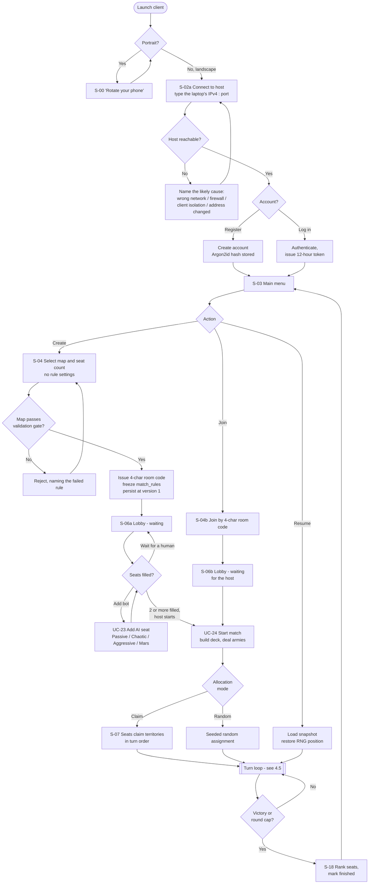

Three differences from the pre-rework version are worth naming, because each one removes a path:

| Removed | Why | Decision |
|---|---|---|
| The `Guest` branch out of *Account* | Login is required; there is nothing to branch to | D-38 |
| *Sea routes placeable?* gate | Routes are a fixed authored list, validated at seed time, not at match time | D-37 |
| *Freeze effective map* | The match **references** an immutable map row instead of copying it | D-50 |
| The `Replay` branch out of the menu | Deferred `[P3]` — S-19 is not built | D-47 |

And one path is added that did not exist at all: **everything above `AUTH`.** On a hotspot the app
cannot find the laptop by itself, so *Connect to host* is now the first thing that happens after the
phone is turned sideways.

## 4.5 Game Flowchart `[P1]`

One turn, including both extensions. Everything in this diagram happens inside the engine, on the
laptop. **The extension branches are `[P2]` and ship switched off** (D-54), so in the first version
the only live attack branch is `Land`.

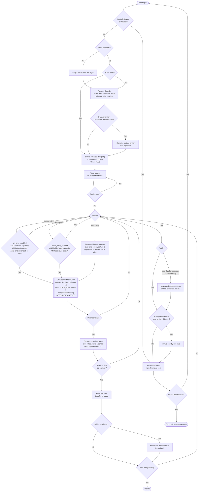

Three things in that diagram are worth naming because they are the extensions in their entirety:

- `CHKA` and `CHKN` are **guards on which targets are legal**. Both funnel into the same `COMBAT` node.
- There is exactly one `COMBAT` node. That is FR-31 drawn rather than stated.
- Each guard's **first clause is the enable flag** read from `match_rules` (D-54). In the first version
  both are `false`, so both branches are unreachable and the diagram collapses to classic RISK — which
  is exactly the build order D-36 asks for, visible in one picture.

## 4.6 Data Flow Diagram — Level 0 (Context) `[P1]`

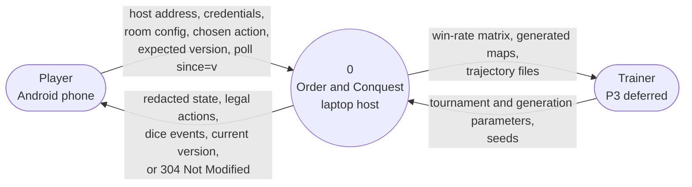

The context diagram has two external entities, and one of them is deferred. Two properties are
deliberate:

- **AI agents are not external.** They run inside the server process, in `OrderAndConquest.Ai`, and
  appear at level 1. Since D-45 the server drives them itself, so no arrow crosses this boundary for an
  AI turn at all — an AI seat is invisible from outside the system.
- **The player's inbound arrow starts with a host address.** On a hotspot that is data the player has to
  supply (FR-88); it is not configuration the system can discover.

## 4.7 Data Flow Diagram — Level 1 `[P1]`

Store names are the real table names from the 13-table schema (chapter 6 §6.4). The map stores are
**read-mostly reference data**, seeded once by `tools/generate_map_seed.py`; the match stores are
per-match state.

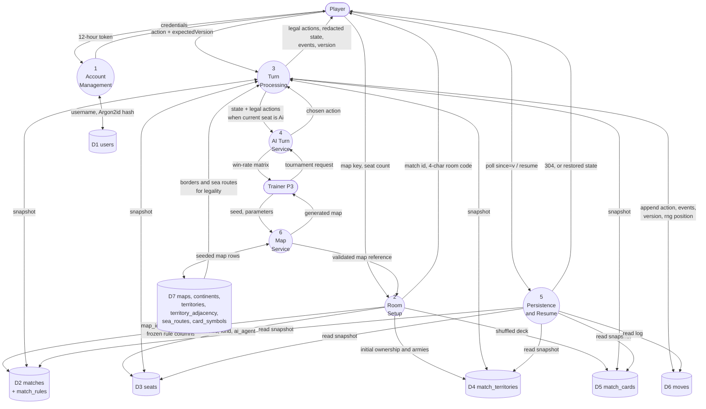

**Store-access rule made visible:** process 3 is the only process with a write arrow into D4 and D5, and
the only process that appends to D6. Process 5 has read arrows only. This is FR-57 and NFR-12 expressed
as a structural property rather than a convention.

**Two changes since the rework, both visible in the arrows:**

1. **D7 is a set of tables, not a file.** It used to be *"map files, read-only"* and process 6 read them
   from disk at run time. The map is now **normalised reference data in the database** (D-50), so
   process 3 can ask the database directly whether two territories share a border. `world_classic.json`
   is still the human-edited source, but it is now a *build input* to the generator, outside this
   diagram.
2. **Process 4 has no arrow to or from the Player.** The AI Turn Service is driven entirely by process
   3 (D-45). The old `ai-step` request arrow is gone, and that is the whole of why three client teams
   no longer need to implement an AI loop.

## 4.8 Data Flow Diagram — Level 2 (Process 3: Turn Processing) `[P1]`

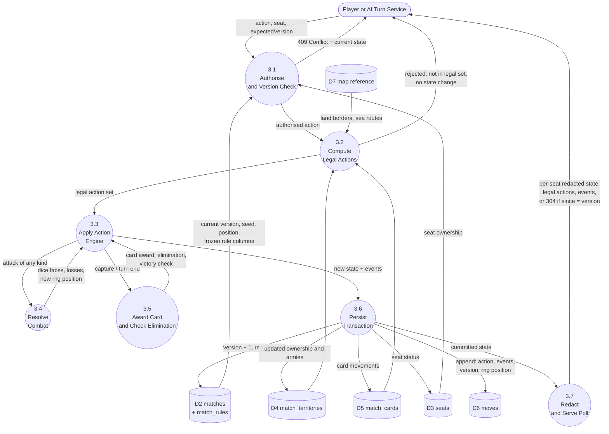

Five properties of this decomposition are deliberate:

1. **3.1 runs before 3.2.** A stale `expectedVersion` is rejected before any rule is evaluated, so a
   conflicting request costs a version read and nothing more (FR-61, D-66).
2. **3.4 is the only source of randomness,** and it returns the new random-source position to 3.3, which
   hands it to 3.6 for persistence. Determinism is a data-flow property here, not a coding convention.
3. **3.7 redacts after commit.** The stored state is complete; only the *view* is reduced (FR-62). One
   stored truth, many redacted views. This is unchanged by the removal of pass-and-play — remote seats
   make it more necessary, not less.
4. **3.7 also answers the poll**, and it is where `304 Not Modified` comes from: if the caller's `since`
   equals the committed version, there is nothing to redact and nothing to send (D-66, FR-89). On a
   three-phone demo most requests take this path, which is what keeps once-a-second polling cheap.
5. **3.1 reads the frozen rule columns from `match_rules`, never from `shared/rules.json`** (D-52,
   FR-87). That is the data-flow expression of *"editing a default cannot change a game in progress"*.

## 4.9 Sequence Diagrams

### 4.9.1 Human action — the normal path `[P1]`

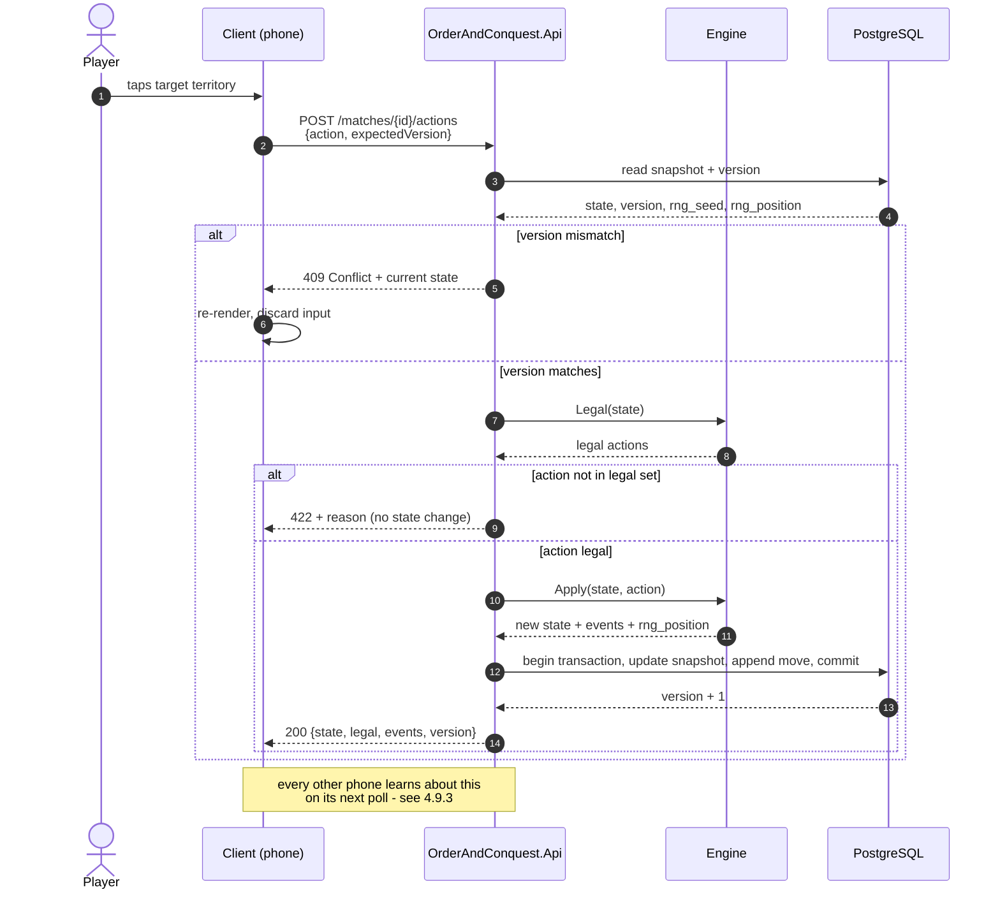

**The hub is gone.** The acting player's own client gets the new state in the `200` response, as it
always did. The *other* phones find out by polling (D-43), which is §4.9.3. There is no broadcast and
no persistent connection to lose.

### 4.9.2 AI turn `[P1]`

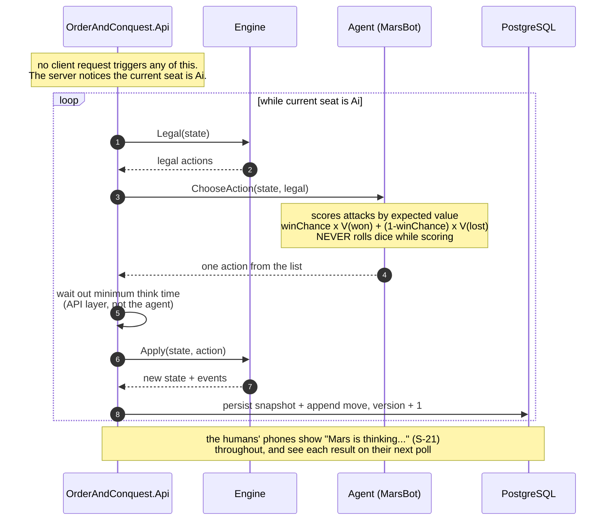

Two notes on this diagram, and both are load-bearing.

**The note on the agent is the single most important line in it.** An agent that called `Apply`
speculatively to see what happens would consume the match random source, and the dice the player then
sees would differ from the dice they would have seen. Scoring is by expected value precisely so that
evaluation has no side effect.

**The note at the top is the second most important.** Nothing in this diagram is a response to a
request (D-45, FR-73). The minimum think time (D-22) now does double duty: it keeps RL training fast by
living at the API layer rather than in the agent, and on a phone it stops a bot's whole turn from
completing between two polls, which would show the human a board that changed with no visible cause.

### 4.9.3 A remote player waits for their turn `[P1]`

> **🔶 This replaces the pass-and-play hand-over diagram** (retired with UC-16 by D-44). The problem it
> solved — *"do not let the outgoing player see the incoming player's cards"* — no longer exists,
> because the two players are holding different phones. The problem that replaces it is **keeping a
> waiting player informed on a phone that is doing nothing**.

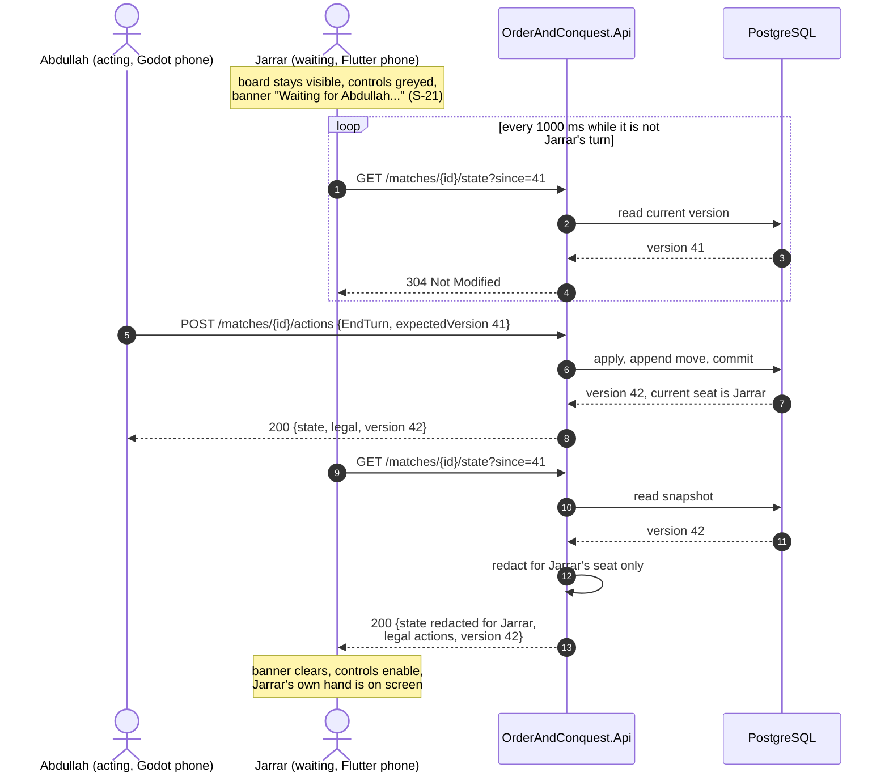

Three properties of this exchange are the whole reason polling is acceptable here:

| Property | Why it matters |
|---|---|
| The waiting phone's requests are **`304` and almost free** — no snapshot read, no redaction, no body | A turn-based game is mostly waiting. Paying full price for that would be the argument for sockets; paying a version read is not (D-66) |
| **Jarrar's hand is never on Abdullah's phone**, at any point | Server-side redaction (FR-62) is unchanged by the loss of pass-and-play. It is now enforced per *device* rather than per *moment*, which is strictly easier to get right |
| The board **stays visible** while waiting | S-21 is not a blocking screen. The old hand-over screen had to blank the display; a waiting player has nothing to hide from, so they get to keep watching the game |

### 4.9.4 Resume `[P1]`

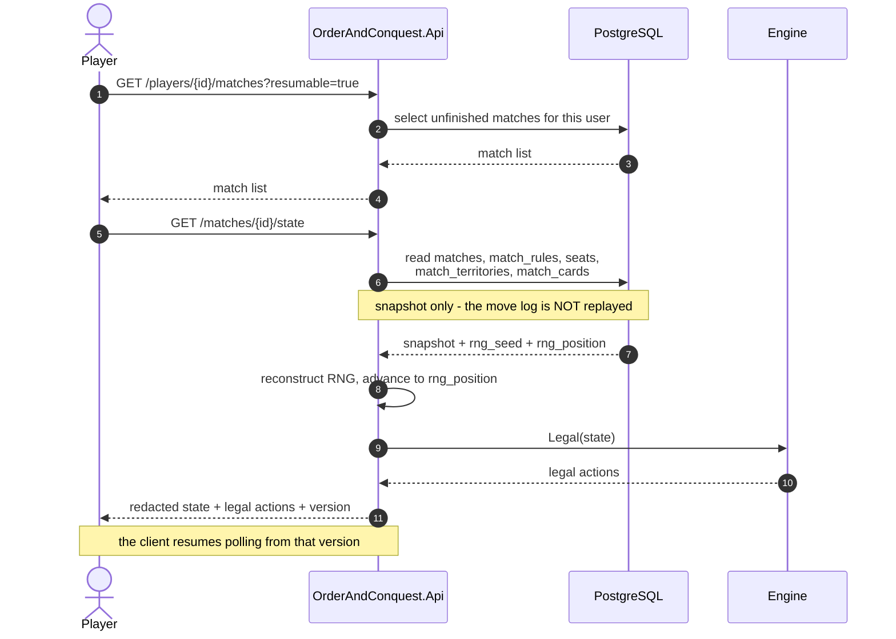

The seat is **not** a query parameter any more: the server derives it from the bearer token, because one
phone is one player. A request for another seat's view is not refused — it is unrepresentable.

### 4.9.5 Reconnecting after the hotspot drops `[P1]` · **NEW**

> **In plain words.** Phone hotspots drop connections. This is the diagram for what the player sees
> when that happens, and it is the one worth rehearsing before task day.

```mermaid
sequenceDiagram
    autonumber
    actor Player
    participant C as Client (phone)
    participant API as OrderAndConquest.Api

    C->>API: GET /matches/{id}/state?since=57
    note over C,API: no response - hotspot dropped
    C->>C: show S-22 "Connection lost - reconnecting..."<br/>board STAYS visible, controls greyed
    loop backing off, with a "Retry now" pill
        C->>API: GET /matches/{id}/state?since=57
    end
    API-->>C: 200 {state, legal, version 61}
    C->>C: S-22 "Reconnected" (green), banner fades
    note over C: four versions were missed.<br/>The client takes the full state it was given;<br/>it does NOT try to replay 58, 59, 60.
```

| Rule | Reason |
|---|---|
| The client re-polls with the **version it last saw**, not with version 0 | If the server has not moved on, the answer is a `304` and the reconnect costs nothing |
| A client that has fallen behind **re-reads full state** rather than replaying a gap | D-66. Replaying a gap means a second state-reconstruction path, and two paths that must agree is exactly the class of bug this architecture exists to avoid |
| **No action is lost or applied twice** | FR-93. Every submitted action carries `expectedVersion`; a duplicate arrives stale and is refused with `409`. Optimistic concurrency was already there for conflicting players, and it pays for itself again here |
| The board **stays on screen** | A blank "reconnecting" screen during a demo looks like a crash. The game is turn-based; a few seconds of staleness is invisible if nothing is hidden |

## 4.10 State Diagrams

### 4.10.1 Match lifecycle `[P1]`

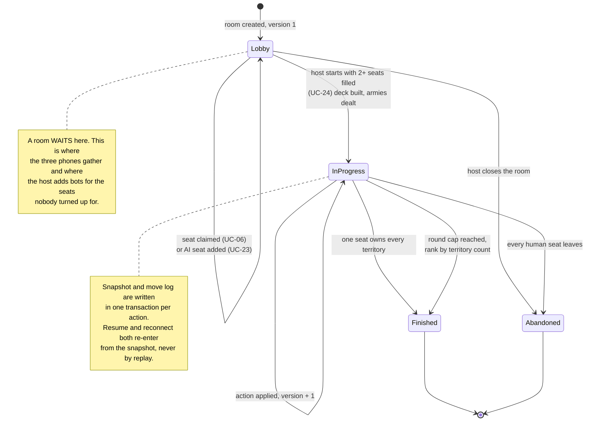

> **🔶 The `Setup` state is gone.** It used to sit between `Lobby` and `InProgress`, holding a match
> whose seats were full but whose territories were not yet allocated. That state existed because
> creation dealt the armies and allocation followed; now **UC-24 does both atomically** (NFR-13), so
> there is no moment when a match is dealt but unallocated. One fewer state is one fewer place for a
> client to be stuck on demo day. Allocation is a step inside the `Lobby → InProgress` transition, and
> screen S-07 renders it.

### 4.10.2 Turn phase machine `[P1]`

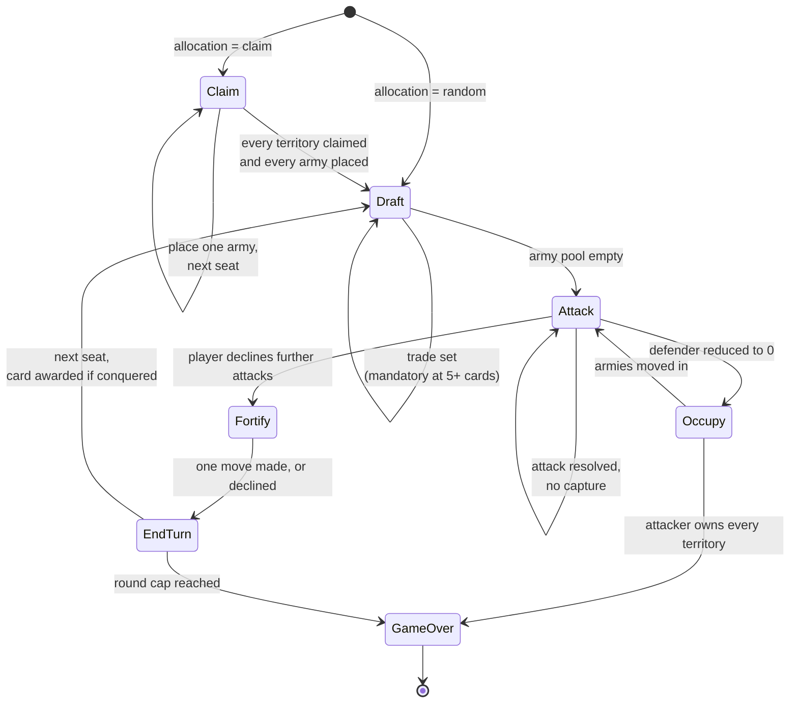

**Air Force and Naval Force add no state.** They are additional transitions out of `Attack` into the same
`Occupy`, which is why this machine is identical to the classic-RISK one. If the extensions had needed a
new phase, that would have been the signal that they were too large — and the diagram is how that would
have been visible.

**Nothing in this machine expires.** There is no timeout transition out of any state, because there is
no turn timer (**O-05 retired by D-65**). A seat whose player has walked away blocks the match until
they return or the host abandons it — which is the correct behaviour for a supervised demo, and is why
the fallback plan in [`15-lan-demo-runbook.md`](15-lan-demo-runbook.md) covers it procedurally rather
than mechanically.

### 4.10.3 Client connection state `[P1]` · **NEW**

The phone's own state machine, which exists because the network is the least reliable part of this
system. It is **orthogonal** to the two machines above: a client can be `Reconnecting` while the match
is perfectly healthy on the laptop.

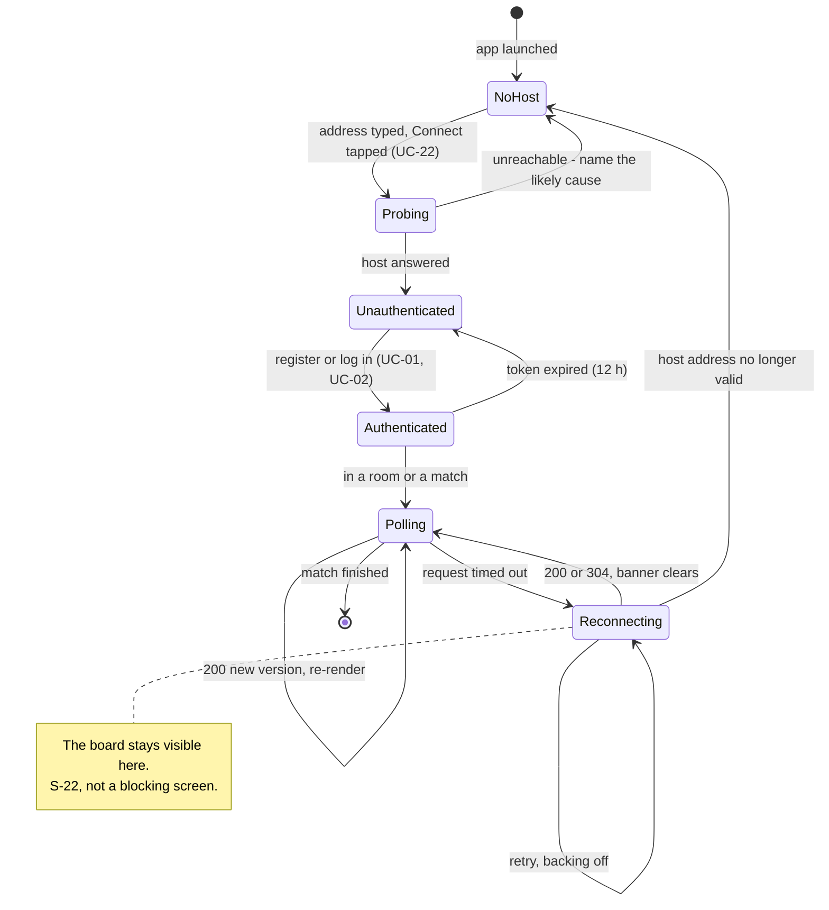

| Transition | Screen | Requirement |
|---|---|---|
| `NoHost → Probing → NoHost` | S-02a, error state | FR-88 |
| `Probing → Unauthenticated` | S-02a → S-02 | FR-88 |
| `Polling → Reconnecting` | S-22 banner over a live board | FR-93 |
| `Reconnecting → Polling` | S-22 "Reconnected", banner fades | FR-93 |
| `Authenticated → Unauthenticated` | back to S-02 | D-61 — and the 12-hour token is chosen so this **cannot happen during task day** |

---

**Previous:** [3 — Requirement Analysis](03-requirements.md) · **Next:** [5 — System Design](05-system-design.md)
