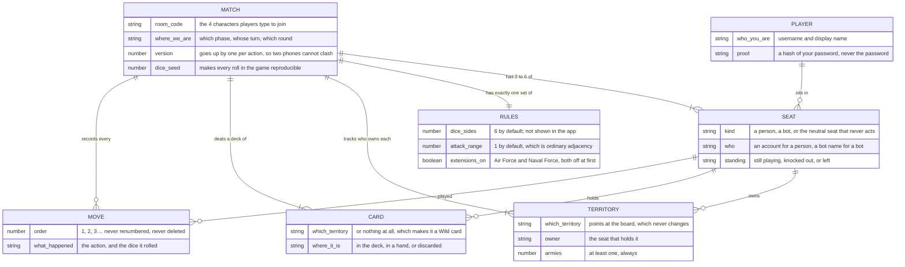

# 6 — Database Design

> **Deliverable K.** Entity-relationship diagrams, entity and attribute definitions, relationships,
> constraints and the full data dictionary. Executable DDL:
> [`appendices/B-database-schema.sql`](../appendices/B-database-schema.sql) · seed:
> [`appendices/B2-seed-world-classic.sql`](../appendices/B2-seed-world-classic.sql) · flat column
> index: [`appendices/B3-data-dictionary.md`](../appendices/B3-data-dictionary.md).

> **In plain words.** The database is one PostgreSQL database on the laptop. It stores three kinds of
> thing: what the **board is** (loaded once, never changes), **who can log in**, and **what is
> happening in each game**. It is split into 13 tables so that every fact is written down exactly once
> and the database itself can refuse to save something impossible — like a territory with no armies on
> it, or a border between two territories that are not on the same map.

**Tier: `[P1]`.** Every table in this chapter is needed for the classic-RISK demo. Two columns are
`[P2]` and both default to off.

---

## 6.1 What changed, and why

This chapter was rewritten in October 2026. The previous design stored the board as **one JSON
document** inside the `matches` table and used **six tables**. The new design stores the board as
**tables** and uses **13**.

| | Then | Now |
|---|---|---|
| Tables | 6 (constraint C-03) | 13 (**D-40**) |
| The map | `matches.effective_map`, a frozen JSON blob | `maps`, `continents`, `territories`, `territory_adjacency`, `sea_routes` (**D-50**) |
| Rule settings | `matches.options`, a JSON blob | `match_rules`, one row per match, real typed columns (**D-52**) |
| Sea routes | generated per match from a count the host picked | a fixed list per map, authored by the team (**D-37**) |
| Card symbol | a stored `cards.symbol` column | derived from the card's territory (**D-51**) |
| Seat kinds | `LocalHuman`, `RemoteHuman`, `Ai`, `Neutral` | `Human`, `Ai`, `Neutral` (**D-55**) |
| Mutable board | `territory_state` | `match_territories` |

The old text is not deleted; it is in §6.11 under **Superseded**. The six-table constraint C-03 is
recorded as superseded in [`00-decisions-and-assumptions.md`](00-decisions-and-assumptions.md).

## 6.2 The one-minute version

The database stores three kinds of thing. The ERD images in §6.6 are colour-coded the same way.

1. **Map data** — what the board *is*: continents, territories, land borders, sea routes. Loaded once
   from a seed file. Never changes while anyone is playing.
2. **Accounts** — who can log in. One row per registered player (**D-38**: there is no guest play).
3. **Match data** — what is happening in one game: whose turn it is, who owns what, who holds which
   cards, and a log of every move ever made.

**How to read an ERD.** A line with a **crow's foot** (three prongs) means "many". A double bar means
"exactly one". A small circle means "optional". So `matches ──< seats` reads *"one match has many
seats"*, and `matches ──|| match_rules` reads *"one match has exactly one rules row"*.

**Speed is not a worry.** The server reads the whole map out of the database **once**, when a match
starts, and keeps it in memory. It never joins the map tables while a move is being played. The
normalised design costs one query at match creation and buys integrity for the rest of the match.

## 6.3 The question we had to settle: map as JSON, or map as tables?

This was a real decision with a real trade-off, so it is written out rather than asserted.

| | JSON blob (the old design) | Normalised tables (this design) |
|---|---|---|
| Does the ERD show the map? | No — it is one column | **Yes** |
| Can the database enforce "a border joins two territories that exist"? | No, only code checks it | **Yes**, foreign keys |
| Can the database enforce "a border is stored once, not twice"? | No | **Yes**, `CHECK (territory_a < territory_b)` |
| Can you query the map in SQL? | Awkward | **Easy** — §6.9 counts Air Force reach in one query |
| Tables to maintain | 6 | 13 |
| Extra work | none | one seed script, generated by a tool |
| Risk: editing a map changes a running game | impossible — it was copied into the match | prevented by a **rule**: a map used by a match is never edited; add a new map row instead |

**Decision: normalised tables (D-50).** Three reasons, in order of weight:

1. The team asked for a fully normalised design, and it is far easier to defend to an examiner. "Where
   is your ERD?" is a question an ERD with one `jsonb` column answers badly.
2. The database can enforce map integrity instead of trusting the loader.
3. It makes the map queryable, which is how the Air Force reach figure in §6.9 is *measured* rather
   than claimed.

**The honest cost** is in the last row of that table. The old design made "a map edit cannot affect a
running match" *structurally impossible*, because the match owned a private copy. The new design makes
it a **rule** instead, and a rule can be broken by someone with a SQL prompt. That is why the rule is
written at the top of the `maps` table in the schema, why the seed is generated rather than
hand-edited, and why §6.10's task-day guide says *insert a new map row* rather than *update the map*.

## 6.4 The 13 tables

### A. Map data — static `[P1]`

| Table | One row is… | Notes |
|---|---|---|
| `card_symbols` | one of the six card symbols | Lookup table: Infantry, Cavalry, Artillery, AirForce, NavalForce, Wild |
| `maps` | one board | `world_classic` today; a second map later is just another row |
| `continents` | a continent on a map | Holds its bonus armies and its colour |
| `territories` | a territory | Belongs to a continent; carries `is_coastal` and its card symbol |
| `territory_adjacency` | a land border between two territories | Stored **once**, smaller id first — so the 83 classic borders are 83 rows, not 166 |
| `sea_routes` | a fixed naval route between two coastal territories | **Empty for now** `[P2]` — needed only for Naval Force |

### B. Accounts `[P1]`

| Table | One row is… | Notes |
|---|---|---|
| `users` | a registered player | Stores a password **hash**, never a password. Username is unique ignoring upper/lower case |

### C. Match data — changes every turn `[P1]`

| Table | One row is… | Notes |
|---|---|---|
| `matches` | one game | Room code, status, phase, whose turn, `version` (stops two phones acting at once), dice seed |
| `match_rules` | the frozen rule settings of one game | Exactly one row per match. Dice sides, attack range, the two extension switches |
| `seats` | one player slot in a game | Kind is `Human`, `Ai` or `Neutral`. A human seat needs a user; an AI seat needs a bot name |
| `match_territories` | who owns a territory in this game, and how many armies are on it | Armies must be at least 1 |
| `match_cards` | one card in this game's deck | In the deck, in a hand, or discarded |
| `moves` | one action that was played | Append-only history, used to resume and replay |

**13 tables, and the count is now an outcome rather than a constraint.** The old limit of six was a
target to hit; this number is simply what one-fact-one-place produces for this game. The scope rule it
replaces — *do not add a table without a recorded reason* — still holds, and every table above has its
reason in the row beside it.

## 6.5 Two deliberate exceptions to strict normalisation

Being straight about these is worth marks in a viva. Both are departures, and both are defensible.

**1. `map_id` is repeated** in `territories`, `territory_adjacency` and `sea_routes`. Strictly it could
be looked up through the continent or the territory, so this is a stored derivable value.

It is kept so the database can use a **composite foreign key**:

```sql
FOREIGN KEY (map_id, territory_a) REFERENCES territories (map_id, territory_id)
```

That single line makes a border between two different maps **unrepresentable**. Without the repeated
column the best available guard is application code. And because the foreign key forces the values to
match, the copy can never disagree with the original — which is the only thing that makes a repeated
column dangerous.

**2. `moves.action` and `moves.events` are `jsonb`.** This is a log: it is append-only, it is read back
whole, and every action type has a different shape — an `Attack` carries dice faces, a `ClaimTerritory`
carries one territory id. Splitting it into one table per action type would add nine tables to model
something nothing ever queries by field.

`moves.action_type` **is** a real column, so the log can be filtered and counted without parsing JSON.

## 6.6 Entity-relationship diagrams

### Conceptual — six ideas, plain English

Six boxes, no database words. This is the diagram to put on a slide.



Three things in that picture are worth saying out loud:

- **A seat, not a player, owns territories.** A person is an account; a seat is that account *in one
  game*. This is why a bot can own territory without having an account, and why the Neutral seat works
  at all.
- **`RULES` is its own box** because the settings are frozen per game. Changing the default cannot
  reach back into a game already running.
- **`MOVE` only ever grows.** Nothing in the system updates or deletes a move.

### Physical — the real tables

Generated **from the running database**, so these diagrams cannot disagree with the SQL.

**Overview** — all 13 tables, keys and relationships only. This is the one for the supervisor meeting.


**Full** — every column. This is the one for the report appendix.


*SVG versions are beside them (`images/erd_overview.svg`, `images/erd_full.svg`) and scale without
blurring if you need to print them large.*

## 6.7 Data dictionary

Every column of all 13 tables, with its type, what it means in plain words, and an example value. A
flat index of the same columns, arranged for searching, is
[`appendices/B3-data-dictionary.md`](../appendices/B3-data-dictionary.md).

`PK` = primary key · `FK` = foreign key · `UK` = unique.

### `card_symbols` — the six symbols `[P1]`

| Column | Type | Null | Meaning | Example |
|---|---|---|---|---|
| `symbol_code` | `text` PK | No | The symbol's name, used everywhere else as a reference | `AirForce` |
| `description` | `text` | No | One sentence on what the symbol does, for a reader of the database | `Owning a territory/card with this symbol unlocks Air Force attacks.` |

Six rows, inserted by the schema itself: `Infantry`, `Cavalry`, `Artillery`, `AirForce`, `NavalForce`,
`Wild`. Four of these were the whole domain in the first design; `AirForce` and `NavalForce` were added
by **D-03**.

### `maps` — one board per row `[P1]`

| Column | Type | Null | Meaning | Example |
|---|---|---|---|---|
| `map_id` | `integer` PK | No | Database id, generated | `1` |
| `map_key` | `text` UK | No | Stable name used by code and by the seed file | `world_classic` |
| `name` | `text` | No | What a person sees | `Classic World` |
| `canvas_width` | `integer` | No | Width of the coordinate space territory labels are placed in | `1600` |
| `canvas_height` | `integer` | No | Height of that space | `900` |
| `created_at` | `timestamptz` | No | When the row was inserted | `2026-10-13 09:12:04+05` |

**The rule that protects running games:** a map used by a match is **never edited**. To change the
board, insert a new row — `world_classic_v2` — and seed it. Matches point at a `map_id`, so an old
match keeps the board it was played on.

### `continents` — a continent of one map `[P1]`

| Column | Type | Null | Meaning | Example |
|---|---|---|---|---|
| `continent_id` | `integer` PK | No | Database id, generated | `3` |
| `map_id` | `integer` FK | No | Which board this continent belongs to | `1` |
| `code` | `text` | No | Short code, unique within the map | `EU` |
| `name` | `text` | No | Display name | `Europe` |
| `bonus_armies` | `integer` | No | Extra armies per turn for holding all of it | `5` |
| `colour` | `text` | No | Hex colour for the board | `#5b8fb9` |

### `territories` — one territory `[P1]`

| Column | Type | Null | Meaning | Example |
|---|---|---|---|---|
| `territory_id` | `integer` PK | No | Database id, generated | `17` |
| `map_id` | `integer` FK | No | Which board | `1` |
| `continent_id` | `integer` FK | No | Which continent. A **composite** FK forces it onto the same map | `3` |
| `key` | `text` | No | Stable name, unique within the map; what the JSON map uses | `northern_europe` |
| `name` | `text` | No | Display name | `Northern Europe` |
| `is_coastal` | `boolean` | No | Whether it touches the sea. **A design decision, not geography** (D-14) | `false` |
| `card_symbol` | `text` FK | No | The symbol on this territory's card. Never `Wild` | `Artillery` |
| `label_x` | `integer` | No | Where the name and army badge are drawn | `700` |
| `label_y` | `integer` | No | ditto | `240` |

**There is no capability column, on purpose (D-10).** A territory's capability profile is worked out
when it is needed:

```
profile(t) = {Infantry} ∪ ({NavalForce} if t.is_coastal) ∪ {t.card_symbol}
```

Storing it would let it disagree with ownership — a seat that lost its last coastal territory would
still look naval. That is trap 3 of
[`14-implementation-safety-checklist.md`](14-implementation-safety-checklist.md).

### `territory_adjacency` — one land border `[P1]`

| Column | Type | Null | Meaning | Example |
|---|---|---|---|---|
| `map_id` | `integer` FK | No | Which board | `1` |
| `territory_a` | `integer` PK, FK | No | One end. Always the **smaller** id | `12` |
| `territory_b` | `integer` PK, FK | No | The other end | `17` |
| `crosses_water` | `boolean` | No | **Drawing hint only.** Draw this border dashed. No game meaning whatsoever | `true` |

`CHECK (territory_a < territory_b)` is what makes "stored once" true rather than hoped for. 83 borders
are 83 rows.

`crosses_water` is the field **D-04** renamed from `seaLanes`, so that the phrase "sea route" means
exactly one thing in this project. A border that crosses water — Alaska to Kamchatka — is an
**ordinary land border** to every rule in the engine.

### `sea_routes` — one naval route `[P2]`

| Column | Type | Null | Meaning | Example |
|---|---|---|---|---|
| `sea_route_id` | `integer` PK | No | Database id, generated | `1` |
| `map_id` | `integer` FK | No | Which board | `1` |
| `territory_a` | `integer` FK, UK | No | One end, the smaller id. Must be coastal | `12` |
| `territory_b` | `integer` FK, UK | No | The other end. Must be coastal | `31` |

**This table ships empty (D-37).** Choosing the fixed list is a game-design decision the team has not
made yet; [`appendices/C-map-specification.md`](../appendices/C-map-specification.md) holds a proposed
list of eight for the team to accept or change. Naval Force is off by default, so classic RISK needs
no row here.

**Why it is a separate table from `territory_adjacency` (D-53).** Air Force range is measured over land
borders only, at every value of `attack_range` (C-08). If sea routes lived in the same table with a
flag, every range query would need to remember to filter on it, and the one that forgot would be a bug
that *looks* fine. Two tables make the mistake impossible to write.

### `users` — a registered account `[P1]`

| Column | Type | Null | Meaning | Example |
|---|---|---|---|---|
| `user_id` | `uuid` PK | No | Database id | `9f1c…` |
| `username` | `text` | No | What you type to sign in. Unique **ignoring case** | `Mujtaba` |
| `password_hash` | `text` | No | **Argon2id hash** in PHC format. Never the password (D-23) | `$argon2id$v=19$m=…` |
| `display_name` | `text` | No | Shown in the lobby and on the board | `Mujtaba` |
| `created_at` | `timestamptz` | No | Registration time | `2026-10-13 09:20:11+05` |
| `last_login_at` | `timestamptz` | **Yes** | Last successful sign-in; null until the first one | `2026-11-02 14:03:55+05` |

**There is no sessions table.** Signing in returns a token that lives 12 hours (**D-61**) — long enough
that it cannot expire during a task day. Refresh tokens and "log out everywhere" would need a table;
both are `[P3]`.

The 2022 report stored passwords in plain text. This is recorded as a **correction**, not a
continuation.

### `matches` — one game `[P1]`

| Column | Type | Null | Meaning | Example |
|---|---|---|---|---|
| `match_id` | `uuid` PK | No | Database id | `3b7a…` |
| `map_id` | `integer` FK | No | Which board this game is played on | `1` |
| `created_by` | `uuid` FK | No | The account that opened the room | `9f1c…` |
| `room_code` | `text` | No | The 4 characters other players type to join (D-60) | `K7QF` |
| `status` | `text` | No | `lobby`, `in_progress`, `finished` or `abandoned` | `in_progress` |
| `phase` | `text` | No | Where in the turn we are: `claim`, `draft`, `attack`, `occupy`, `fortify`, `end_turn`, `game_over` | `attack` |
| `current_seat_no` | `smallint` FK | **Yes** | Whose turn it is. Null while the match is in the lobby | `0` |
| `round_no` | `integer` | No | Completed full cycles of all seats | `7` |
| `trade_index` | `integer` | No | How many card sets have been traded in this game. Only ever goes up (DR-13) | `3` |
| `version` | `bigint` | No | **+1 on every applied action.** The whole concurrency design (§6.8) | `214` |
| `rng_seed` | `bigint` | No | Seed of the match's random source | `20261013` |
| `rng_position` | `bigint` | No | How many random draws have been consumed. With the seed, reconstructs every die exactly | `488` |
| `winner_seat_no` | `smallint` FK | **Yes** | Set only when `status = 'finished'` | `0` |
| `created_at` | `timestamptz` | No | Room opened | `2026-11-02 14:05:00+05` |
| `started_at` | `timestamptz` | **Yes** | Match started; null while in the lobby | `2026-11-02 14:09:12+05` |
| `finished_at` | `timestamptz` | **Yes** | Match ended | `2026-11-02 15:41:30+05` |
| `updated_at` | `timestamptz` | No | Touched on every applied action | `2026-11-02 15:12:44+05` |

Three columns deserve a sentence of their own:

- **`version`** is what stops two phones acting at once. See §6.8.
- **`rng_seed` + `rng_position`** are what make the game reproducible. A deterministic game can be
  replayed from its log; a stochastic one cannot.
- **`trade_index`** is the match-wide position in the card-escalation table. It never resets, not even
  when a player is eliminated.

**What is *not* here any more:** no `effective_map` (the map is reached through `map_id`), no `options`
blob (the rules are in `match_rules`), no `mask`, and **no turn timer** — O-05 is retired (**D-65**),
because nothing in this game expires.

### `match_rules` — the frozen settings of one game `[P1]`

Exactly one row per match. Copied from `shared/rules.json` when the match is created, then **never read
live again**.

| Column | Type | Null | Default | Meaning | Example |
|---|---|---|---|---|---|
| `match_id` | `uuid` PK, FK | No | — | Which game | `3b7a…` |
| `dice_sides` | `smallint` | No | `6` | Faces per die. Allowed 2–20. **Not shown in the app** (D-39) | `6` |
| `attack_range` | `smallint` | No | `1` | How far a land attack reaches. `1` **is** ordinary adjacency. Allowed 1–10 | `1` |
| `defender_wins_ties` | `boolean` | No | `true` | On an equal pair of dice the defender holds | `true` |
| `territory_allocation` | `text` | No | `claim` | How the board is divided at the start: `claim` or `random` | `claim` |
| `fortify_mode` | `text` | No | `single_pair` | Which fortify rule: `single_pair`, `one_step_all`, `connected_path` | `single_pair` |
| `wild_cards` | `smallint` | No | `2` | How many Wild cards are in the deck | `2` |
| `round_cap` | `integer` | No | `100` | Rounds before the game is called on territory count | `100` |
| `air_force_enabled` | `boolean` | No | `false` | `[P2]` Air Force on or off | `false` |
| `air_max_range` | `smallint` | No | `5` | `[P2]` Air Force reach in land steps. Allowed 1–10 | `5` |
| `air_attacks_per_turn` | `smallint` | No | `1` | `[P2]` Air attacks allowed per turn (assumption AIR-1) | `1` |
| `naval_force_enabled` | `boolean` | No | `false` | `[P2]` Naval Force on or off | `false` |

**This table is trap 6 of the safety checklist, written as a schema.** If the engine ever reads
`dice_sides` live from `shared/rules.json` instead of from here, a resumed match consumes *exactly the
same number of random draws as before* — so `rng_position` tracks the log perfectly, the whole
determinism suite stays green, and every single die face is different. Only a test that asks *where the
number came from* catches it: **TC-PER-07** asserts the source, not the value.

At the defaults, this row describes **exactly classic RISK**, which is what makes both settings additive
rather than a rules change (D-29, D-30).

### `seats` — one player slot `[P1]`

| Column | Type | Null | Meaning | Example |
|---|---|---|---|---|
| `match_id` | `uuid` PK, FK | No | Which game | `3b7a…` |
| `seat_no` | `smallint` PK | No | 0–5. Also the turn order | `0` |
| `kind` | `text` | No | `Human`, `Ai` or `Neutral` | `Human` |
| `user_id` | `uuid` FK | **Yes** | The account in this seat. Required for `Human`, null otherwise | `9f1c…` |
| `ai_agent` | `text` | **Yes** | Bot name. Required for `Ai`, null otherwise | `MarsBot` |
| `colour` | `text` | No | Seat colour, hex. The six seat colours of the design pack | `#FF0103` |
| `status` | `text` | No | `active`, `eliminated` or `left` | `active` |
| `eliminated_by_seat` | `smallint` FK | **Yes** | Who knocked this seat out. Drives card transfer (FR-38) | `2` |
| `eliminated_round` | `integer` | **Yes** | The round it happened in | `11` |
| `final_rank` | `smallint` | **Yes** | 1–6, filled in when the game ends | `3` |

Which columns must be filled depends on the kind of seat, and the database enforces it:

| `kind` | `user_id` | `ai_agent` | Acts? |
|---|---|---|---|
| `Human` | **required** | null | Yes, over the network |
| `Ai` | null | **required** | Yes — the **server** runs its turn (D-45) |
| `Neutral` | null | null | **No** — it defends only, and the server skips its turn (DR-15) |

**Three kinds, not four.** `LocalHuman` and `RemoteHuman` collapse into `Human` (**D-55**) because
single-device play is gone (**D-44**). Every human seat is now remote by definition.

**The Neutral seat appears in 2-player matches only** (D-07, confirmed as **D-62**). A 2-player game is
three seats — two players and Neutral — which is what makes the 3-player starting-army row of 35 apply
with no special case.

**`ai_agent` lists four bots:** `PassiveBot` and `MarsBot` are `[P1]`, `ChaoticBot` and
`AggressiveBot` are `[P2]` (**D-56**). The ONNX/RL agent is `[P3]` and is deliberately absent from the
constraint — adding it later is a one-line migration.

One account cannot hold two seats in the same match: `ux_seats_one_seat_per_user`.

### `match_territories` — the mutable board `[P1]`

| Column | Type | Null | Meaning | Example |
|---|---|---|---|---|
| `match_id` | `uuid` PK, FK | No | Which game | `3b7a…` |
| `territory_id` | `integer` PK, FK | No | Which territory on the board | `17` |
| `owner_seat_no` | `smallint` FK | No | The seat that owns it | `0` |
| `armies` | `integer` | No | How many armies are on it. **At least 1, always** (DR-04) | `12` |

This is the **only** mutable part of the board, and it is only two facts wide: who owns it, how many
armies. Everything permanent about the territory is reached through `territory_id`, never copied here.

A row appears when a territory is first claimed. After the claim phase, every territory of the map has
exactly one row — 42 rows on the classic board.

### `match_cards` — the deck `[P1]`

| Column | Type | Null | Meaning | Example |
|---|---|---|---|---|
| `match_id` | `uuid` PK, FK | No | Which game | `3b7a…` |
| `card_no` | `smallint` PK | No | 1-based card number within this match | `7` |
| `territory_id` | `integer` FK, UK | **Yes** | The territory on the card. **Null makes it a Wild card** | `17` |
| `location` | `text` | No | `deck`, `hand` or `discard` | `hand` |
| `holder_seat_no` | `smallint` FK | **Yes** | Who holds it. Non-null **if and only if** `location = 'hand'` | `0` |
| `deck_order` | `integer` | **Yes** | Shuffled position. Non-null **if and only if** `location = 'deck'` | `23` |

44 cards on the classic board: 42 territory cards plus 2 Wild.

**The symbol is not stored (D-51).** It is the territory's `card_symbol`, or `Wild` when
`territory_id` is null. One fact, one place — and a card can never claim a symbol its territory does
not have.

**The deck keeps its Air Force and Naval Force symbols even in the classic-only build** (**D-63**). A
symbol is a set-matching token; `air_force_enabled = false` removes the *action*, not the card.
Changing the deck for the first version would change every card test oracle twice.

**Both `location` CHECKs are biconditional**, and that is the point:

```sql
CHECK ((location = 'hand') = (holder_seat_no IS NOT NULL))
CHECK ((location = 'deck') = (deck_order     IS NOT NULL))
```

They forbid the half-consistent row in **both** directions — a held card with no holder, and a holder on
a card that is not in a hand. That half-state is the one that produces the bug nobody can reproduce.

### `moves` — the append-only log `[P1]`

| Column | Type | Null | Meaning | Example |
|---|---|---|---|---|
| `match_id` | `uuid` PK, FK | No | Which game | `3b7a…` |
| `seq` | `bigint` PK | No | 1, 2, 3 … contiguous, never renumbered | `88` |
| `seat_no` | `smallint` FK | No | Who acted | `0` |
| `round_no` | `integer` | No | Which round it happened in | `7` |
| `phase` | `text` | No | Which phase it happened in | `attack` |
| `action_type` | `text` | No | A real column, so the log can be filtered without parsing JSON | `Attack` |
| `action` | `jsonb` | No | The action exactly as submitted | `{"from":"kamchatka","to":"alaska","dice":3}` |
| `events` | `jsonb` | No | What happened, **including every die face** | `{"attacker":[6,4,2],"defender":[5,3],"losses":{"att":1,"def":1}}` |
| `version_after` | `bigint` | No | `matches.version` after this action | `89` |
| `rng_position_after` | `bigint` | No | `matches.rng_position` after this action (TC-DET-03) | `203` |
| `created_at` | `timestamptz` | No | Wall-clock time. **Audit only, never a rule input** | `2026-11-02 15:12:44+05` |

That last note is deliberate. A timestamp that influenced a rule would make the match non-reproducible,
so the column is documented as audit-only to stop it becoming a temptation.

**Append-only is a convention here, not a privilege (D-64).** Nothing in the server issues an `UPDATE`
or a `DELETE` against this table, and **TC-DB-11** asserts the log never shrinks. To enforce it at the
database instead, uncomment two lines in the schema:

```sql
REVOKE UPDATE, DELETE ON moves FROM app_user;
GRANT  INSERT, SELECT ON moves TO   app_user;
```

`[P3]`, and worth doing if a supervisor asks how an append-only log is *guaranteed*: a privilege is a
guarantee, application discipline is a promise.

## 6.8 Constraints, relationships and how concurrency works

### Relationships

| Relationship | Cardinality | On delete |
|---|---|---|
| `maps` → `continents` | 1 : N | restrict — a map in use is never deleted |
| `maps` → `territories` | 1 : N | restrict |
| `continents` → `territories` | 1 : N | restrict, **composite** `(map_id, continent_id)` |
| `territories` → `territory_adjacency` | 1 : N (twice) | restrict, **composite** `(map_id, territory_*)` |
| `territories` → `sea_routes` | 1 : N (twice) | restrict, composite |
| `card_symbols` → `territories` | 1 : N | restrict |
| `users` → `seats` | 1 : 0..N | restrict — deleting an account must not destroy other players' history |
| `matches` → `match_rules` | **1 : 1** | cascade |
| `matches` → `seats` | 1 : 2..6 | cascade |
| `matches` → `match_territories` | 1 : N | cascade |
| `matches` → `match_cards` | 1 : N | cascade |
| `matches` → `moves` | 1 : 0..N | cascade |
| `seats` → `match_territories` | 1 : 0..N | composite `(match_id, owner_seat_no)` |
| `seats` → `match_cards` | 1 : 0..N | composite, nullable |
| `seats` → `moves` | 1 : 0..N | composite |

**Every child key inside a match includes `match_id`.** A territory row cannot point at a seat in a
different match, because the foreign key makes it unrepresentable rather than merely discouraged.

### Check constraints

| ID | Table | Constraint | Enforces |
|---|---|---|---|
| CK-01 | `matches` | `status IN ('lobby','in_progress','finished','abandoned')` | §4.10.1 |
| CK-02 | `matches` | `phase IN ('claim','draft','attack','occupy','fortify','end_turn','game_over')` | §4.10.2 |
| CK-03 | `matches` | `version >= 1` | Optimistic concurrency |
| CK-04 | `matches` | `rng_position >= 0` | Determinism |
| CK-05 | `matches` | `trade_index >= 0` | DR-13 |
| CK-06 | `matches` | `round_no >= 0` | Round cap |
| CK-07 | `matches` | `(winner_seat_no IS NOT NULL) <= (status = 'finished')` | A winner exists only in a finished game |
| CK-08 | `seats` | `seat_no BETWEEN 0 AND 5` | FR-12 |
| CK-09 | `seats` | `kind IN ('Human','Ai','Neutral')` | D-55 |
| CK-10 | `seats` | the three-way kind / `user_id` / `ai_agent` rule | FR-13 |
| CK-11 | `seats` | `status IN ('active','eliminated','left')` | FR-53 |
| CK-12 | `seats` | `ai_agent IN ('PassiveBot','ChaoticBot','AggressiveBot','MarsBot')` | D-56 |
| CK-13 | `seats` | `eliminated_by_seat <> seat_no` | A seat cannot eliminate itself |
| CK-14 | `match_territories` | `armies >= 1` | DR-04 — a territory is never empty |
| CK-15 | `match_cards` | `location IN ('deck','hand','discard')` | §6.7 |
| CK-16 | `match_cards` | `(location = 'hand') = (holder_seat_no IS NOT NULL)` | Biconditional |
| CK-17 | `match_cards` | `(location = 'deck') = (deck_order IS NOT NULL)` | Biconditional |
| CK-18 | `territories` | `card_symbol <> 'Wild'` | A territory never carries Wild (D-20) |
| CK-19 | `territory_adjacency` | `territory_a < territory_b` | Each border stored once |
| CK-20 | `sea_routes` | `territory_a < territory_b` | Each route stored once |
| CK-21 | `match_rules` | `dice_sides BETWEEN 2 AND 20` | D-29 |
| CK-22 | `match_rules` | `attack_range BETWEEN 1 AND 10` | D-30 |
| CK-23 | `match_rules` | `air_max_range BETWEEN 1 AND 10` | D-11 |
| CK-24 | `moves` | `seq >= 1`, `version_after >= 1`, `rng_position_after >= 0` | Append order, log/snapshot agreement |

### Unique constraints and indexes

| Name | Table | Columns | Purpose |
|---|---|---|---|
| `ux_users_username` | `users` | `lower(username)` | Sign-up is case-insensitive |
| `ux_matches_active_room_code` | `matches` | `room_code` where `status IN ('lobby','in_progress')` | A code is unique **among running games**; a finished match releases it |
| `ux_seats_one_seat_per_user` | `seats` | `(match_id, user_id)` where not null | One account, one seat per game |
| — | `maps` | `map_key` | Stable map name |
| — | `continents` | `(map_id, code)` | Continent codes are unique per map |
| — | `territories` | `(map_id, key)` | Territory keys are unique per map |
| — | `match_cards` | `(match_id, territory_id)` | One card per territory |
| `ix_seats_user` | `seats` | `(user_id)` where not null | The resumable-match list (FR-04) |
| `ix_match_territories_owner` | `match_territories` | `(match_id, owner_seat_no)` | Territory count per seat, every draft phase |
| `ix_match_cards_hand` | `match_cards` | `(match_id, holder_seat_no)` where in a hand | Hand retrieval |

### Invariants SQL cannot express cheaply

Four, each enforced by the engine and each with a test:

| Invariant | Test |
|---|---|
| Every territory of the match's map has exactly one `match_territories` row after the claim phase | TC-PER-02 |
| The deck is exactly the map's territories plus `wild_cards` Wilds | TC-PER-03 |
| When `status = 'finished'` by domination, one seat is `active` and owns every territory | TC-VIC-01 |
| `matches.rng_position` equals `rng_position_after` of the highest `seq` in `moves` | TC-DET-03 |

The last is the schema-level statement of determinism: if the snapshot and the log disagree about the
random-source position, the match is not reproducible — and that is detectable without playing it.

### One action, one transaction

```sql
BEGIN;

UPDATE matches
   SET version         = version + 1,
       rng_position    = @newPosition,
       phase           = @phase,
       current_seat_no = @currentSeat,
       round_no        = @round,
       trade_index     = @tradeIndex,
       updated_at      = now()
 WHERE match_id = @matchId
   AND version  = @expectedVersion;     -- 0 rows => 409 Conflict, nothing applied

-- match_territories, match_cards and seats updated from the new state

INSERT INTO moves (match_id, seq, seat_no, round_no, phase, action_type,
                   action, events, version_after, rng_position_after)
VALUES (@matchId, @seq, @seat, @round, @phase, @actionType,
        @action, @events, @newVersion, @newPosition);

COMMIT;
```

`AND version = @expectedVersion` is the whole concurrency design, and it matters more now than it did
before: with three phones **polling once a second** (D-43) and the server running AI turns on its own
(D-45), two actions arriving close together is the normal case, not an edge case. If the clause matches
no row, the transaction affects nothing, the client gets `409` with the current state, and no partial
write ever existed (FR-61, NFR-13).

## 6.9 What was tested

### Verified by independent computation ✅

Run on this machine with `python tools/generate_map_seed.py --stats`, which reads
`shared/maps/world_classic.json` and recomputes everything from the raw adjacency lists:

| Claim | Expected | Measured | |
|---|---|---|---|
| Continents | 6 | **6** | ✅ |
| Territories | 42 | **42** | ✅ |
| Coastal / landlocked | 36 / 6 | **36 / 6** | ✅ |
| Land borders, each stored once | 83 | **83** | ✅ |
| Borders marked `crosses_water` | 10 | **10** | ✅ |
| Card symbols on territories | 12 / 10 / 8 / 7 / 5 | **12 / 10 / 8 / 7 / 5** | ✅ |
| Deck size (42 territories + 2 Wild) | 44 | **44** | ✅ |
| Ordered territory pairs | 1,722 | **1,722** | ✅ |
| Ordered pairs within 5 **land** steps | 1,330 (77.2 %) | **1,330 (77.2 %)** | ✅ |
| Land graph diameter | 10 | **10** | ✅ |

The same run re-derives all 42 capability profiles by rule CAP-1 and asserts them equal to the authored
`capabilities` arrays, checks that the adjacency graph is symmetric and connected, and confirms that
every `crossesWater` pair is a real land border. It refused nothing, so all of that holds.

It also reproduces the **O-04** measurement exactly: reach at range 5 runs from **11 of 41** (Eastern
Australia) to **40 of 41** (Ukraine), mean **31.7**. Eastern Australia is air-capable and is the worst
square on the board from which to use the capability — which is why O-04 is still open.

### Not verified here ⚠️

**PostgreSQL is not installed on the machine where this chapter was written.** The schema and seed have
therefore **not been loaded**, and no claim below has been run:

| Claim | Status |
|---|---|
| Schema and seed load in one go on an empty database | ⚠️ **not verified** |
| `information_schema` reports 13 base tables | ⚠️ **not verified** |
| The recursive SQL reach query returns 1,330 | ⚠️ **not verified** — but the same number was computed independently in Python, above |
| A sample match with 2 human seats, 1 bot seat, 42 owned territories, a 44-card deck and one logged move | ⚠️ **not verified** |
| The database rejects all ten impossible rows (TC-DB-01…10) | ⚠️ **not verified** |

Everything needed to turn those five rows into ✅ is written and waiting:

```bash
createdb order_and_conquest
psql -d order_and_conquest -f appendices/B-database-schema.sql
psql -d order_and_conquest -f appendices/B2-seed-world-classic.sql
psql -d order_and_conquest -f tools/verify_db.sql      # prints every count above
```

`tools/verify_db.sql` prints a PASS/FAIL line per count, runs six map-validation queries that must all
return zero rows, and attempts the ten impossible inserts inside a transaction it rolls back. It is
**step 6 of [`15-lan-demo-runbook.md`](15-lan-demo-runbook.md)**. Until someone runs it, the report says
*not verified* — not *passed*.

> **The incoming design pack states that all of the above was run on PostgreSQL 16.** That is very
> likely true, and it is why the numbers agree. It is recorded here as **the pack's claim, not this
> repository's evidence**, because this rework could not reproduce it.

### The ten rejection cases

These are the constraints doing their job. Each is a test case in
[`appendices/F-test-cases.md`](../appendices/F-test-cases.md) and is attempted by
`tools/verify_db.sql` Part 3.

| Test | What is attempted | What must refuse it |
|---|---|---|
| TC-DB-01 | A territory with 0 armies | CK-14 |
| TC-DB-02 | A border written backwards (bigger id first) | CK-19 |
| TC-DB-03 | A `Human` seat with no account | CK-10 |
| TC-DB-04 | One account taking two seats in one match | `ux_seats_one_seat_per_user` |
| TC-DB-05 | A second rules row for one match | `match_rules` primary key |
| TC-DB-06 | `dice_sides = 21` | CK-21 |
| TC-DB-07 | A winner while the game is still running | CK-07 |
| TC-DB-08 | Re-using the room code of a running game | `ux_matches_active_room_code` |
| TC-DB-09 | A territory carrying the `Wild` symbol | CK-18 |
| TC-DB-10 | A card in a hand with no holder | CK-16 |
| TC-DB-11 | Deleting a row from `moves` | Convention `[P1]`; privilege `[P3]` (D-64) |

## 6.10 How to change things on task day

The full version, with a verification step for each row, is
[`16-task-day-change-guide.md`](16-task-day-change-guide.md). This is the database half.

| The committee says… | You do… | Where |
|---|---|---|
| "Make the dice 8-sided" | Create the match with `dice_sides = 8` (allowed 2–20). **Before it starts** | `match_rules.dice_sides` |
| "Let units attack two territories away" | Create the match with `attack_range = 2` (allowed 1–10) | `match_rules.attack_range` |
| "Turn on the Air Force" | `air_force_enabled = true`, and `air_max_range` if they ask for a different reach | `match_rules` |
| "Turn on the Naval Force" | `naval_force_enabled = true` — **and add at least one sea route first**, or the capability has nothing to do | `match_rules`, `sea_routes` |
| "Add another sea route" | Add the pair to `seaRoutes` in `shared/maps/world_classic.json`, run `python tools/generate_map_seed.py`, re-seed | JSON → generator → `sea_routes` |
| "Add an AI bot" | Insert a seat with `kind = 'Ai'` and an `ai_agent` from the four allowed names | `seats` |
| "Change the starting armies" | `shared/rules.json` → `setup.startingArmies`. Takes effect on the **next** match created | `rules.json` |
| "Use a different map" | Insert a **new** `maps` row, then its continents, territories and borders. Never edit a map a match has used | `maps` + seed |
| "Reset the match" | Abandon it (`status = 'abandoned'`) and create a new room. Do not delete rows | `matches.status` |

**Why none of this can corrupt a running game:** every value above is read from `match_rules` for
matches that already exist, and `match_rules` is written once, at creation. Changing a default changes
the next match, never the current one.

## 6.11 Superseded — the previous six-table design

Kept for the record, because the report has to explain what changed and why. Nothing here is current.

<details>
<summary>The six-table design (C-03), superseded by D-40 in October 2026</summary>

Six tables: `users`, `matches`, `seats`, `territory_state`, `cards`, `moves`.

The count was achievable because of one decision: **the board was stored as data, not as schema.**
`matches.effective_map` held the normalised map — territories, adjacency, continents, capability
profiles and the generated sea routes — as one frozen JSON document. Only the mutable part of the
board, ownership and army count, got a row per territory, in `territory_state`.

| Principle | Consequence |
|---|---|
| Snapshot **and** append-only log | Resume is O(1) in match length; replay is complete |
| One transaction per applied action | A crash leaves no half-applied action (NFR-13) |
| Immutable data frozen as JSON | Map edits could not affect a running match (FR-10) |
| Derived data is never stored | Capability computed from ownership; no capability column (FR-41) |
| Vendor-neutral types | `text` with `CHECK` instead of enums; portable to SQLite (NFR-19) |

`matches.options` was a `jsonb` column holding allocation mode, fortify mode, round cap, difficulty,
turn timer, sea-route count and — after D-29/D-30 — die-face count and attack range.

`cards.symbol` was a stored column with a six-value `CHECK`, extended from four by D-03.

Seat kinds were `LocalHuman`, `RemoteHuman`, `Ai` and `Neutral`.

**Why it was replaced.** The team asked for a fully normalised design that an ERD could actually show,
and for the database rather than the loader to enforce map integrity (D-40, D-50). Three of the five
principles above survive unchanged and are still the principles of the current design; only "immutable
data frozen as JSON" is gone, replaced by the immutable-map rule in §6.3.

### Portability note, also superseded in effect

PostgreSQL was the target, with a SQLite substitution table for headless simulation (NFR-19). The
substitution still works — no enum types, no arrays, no domain types, no stored procedures are used
anywhere, and the only new construct is `GENERATED ALWAYS AS IDENTITY`, which SQLite spells
`INTEGER PRIMARY KEY AUTOINCREMENT`. But headless simulation is `[P3]` now, so nothing in the
prototype depends on it.

| PostgreSQL | SQLite |
|---|---|
| `uuid` | `text`, canonical hyphenated form |
| `jsonb` | `text`, serialised identically |
| `timestamptz` | `text`, ISO-8601 UTC |
| `bigint` | `INTEGER` (64-bit in SQLite) |
| `gen_random_uuid()` | application-generated |
| `GENERATED ALWAYS AS IDENTITY` | `INTEGER PRIMARY KEY AUTOINCREMENT` |
| `REVOKE UPDATE, DELETE` | a trigger that raises on update/delete |

</details>

---

**Previous:** [5 — System Design](05-system-design.md) · **Next:** [7 — Game Design and Rules](07-game-design.md)
